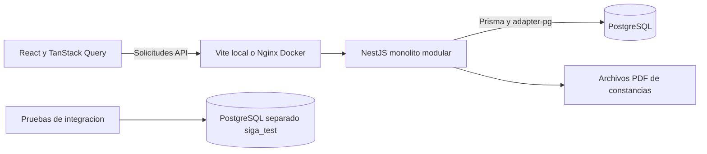

# Arquitectura y alcance de SIGA

El SIGA es un portal de gestion academica local para estudiantes, docentes y administradores. Una consulta publica limitada permite verificar constancias. Esta descripcion se basa en el codigo; las pruebas vigentes y pendientes se encuentran en [ESTADO](ESTADO.md). La [explicacion para principiantes](EXPLICACION_ARQUITECTURA.md) explica las mismas partes paso a paso.

`apps/web` presenta las pantallas; `apps/api` contiene HTTP, reglas y acceso a datos; `packages/contracts` comparte contratos. El navegador no recibe acceso directo a PostgreSQL. La API comprueba sesion, rol y propiedad o asignacion segun el recurso; el proxy no sustituye la autorizacion. Los modulos cubren autenticacion, catalogos, personas, oferta, matriculas, calificaciones, certificados, reportes y salud.

Administracion configura planes, personas, periodos y grupos. El estudiante solicita matricula; la API comprueba elegibilidad, ventana y cupo. El docente asignado captura o corrige la nota, y el estudiante consulta historial, promedio y avance. Una constancia conserva una instantanea y un PDF con huella; una correccion posterior no altera el PDF anterior. Una reemision conserva el enlace historico. El [modelo de datos](modelo-datos.md) explica las relaciones y restricciones.

Las consultas de cuentas activas y grupos propios admiten busqueda y paginas con `q`, `page` y `pageSize`; responden con `items`, `page`, `pageSize` y `total`. Si no se envia ningun parametro, conservan el arreglo anterior limitado a 50 cuentas o 100 grupos para clientes existentes. La busqueda de grupos siempre se limita al docente de la sesion y la de cuentas requiere administracion.

## Entradas, procesos, salidas y retroalimentacion (ENT-TGS)

| Subsistema          | Entrada                                 | Proceso                                                                          | Salida o retroalimentacion                                           |
| ------------------- | --------------------------------------- | -------------------------------------------------------------------------------- | -------------------------------------------------------------------- |
| Catalogo y oferta   | Plan, materias, periodo, docente y cupo | Validar relaciones, grafo sin ciclos y estado activo                             | Oferta elegible o motivo de rechazo; bitacora transaccional          |
| Matricula           | Estudiante, grupo y ventana horaria     | Comprobar ventana `America/Mexico_City`, prerrequisitos y cupo en transaccion    | Inscripcion confirmada o bloqueo; ocupacion actualizada              |
| Calificaciones      | Nota final, version esperada y motivo   | Validar asignacion docente, escala y control optimista; ponderar por creditos    | Kardex, promedio y avance; desbloqueo de prerrequisitos y constancia |
| Constancias         | Solicitud e intentos calificados        | Congelar instantanea JSON, generar PDF/QR Unicode o estandar y registrar SHA-256 | Descarga verificada, consulta publica y recuperacion ante fallos     |
| Reportes y bitacora | Filtros de grupo, estudiante o recurso  | Consultar con paginacion, sanitizar CSV y registrar `anterior`/`posterior`       | Exportacion CSV integra y trazabilidad auditable                     |
| Operacion           | Base PostgreSQL y carpeta de PDFs       | Respaldar, verificar restauracion aislada y conciliar huerfanos                  | Evidencia de integridad y disponibilidad para el operador            |

### Ejemplo verificable extremo a extremo entre subsistemas (datos sinteticos)

1. **Catálogo y oferta (entrada -> estructura):** Administración registra dentro del programa sintético de demostración (`D41`) un plan versión `1` con `30` créditos totales y las asignaturas `PROG-101` (`6` créditos), `MAT-101` (`4` créditos) y `EST-201` (`6` créditos, con prerrequisito `PROG-101`), y abre el período `2026-1` con ventana vigente en `America/Mexico_City` (`D44`) y política académica `D42` (escala `0–10`, mínima aprobatoria `6.00`, regla `TODOS`).
2. **Matrícula (estructura -> control de elegibilidad):** El estudiante ficticio se inscribe en `PROG-101` y `MAT-101` (ocupación incrementa y `creditosSnapshot` queda congelado). Si solicita `EST-201` en ese mismo período, la oferta y `POST /matriculas` rechazan la inscripción porque `PROG-101` aún figura como `INSCRITA` sin calificación aprobatoria (`RN-01`).
3. **Calificaciones -> Avance y retroalimentación hacia Matrícula y Constancias:** El docente asignado captura `9.00` en `PROG-101` (`6` créditos) y `7.50` en `MAT-101` (`4` créditos). El motor de cálculo (`calificaciones.calculo.ts`) obtiene un promedio ponderado de $\frac{9.00 \times 6 + 7.50 \times 4}{6 + 4} = 8.40$ y un avance curricular de $\frac{10}{30} = 33.33\,\%$. Esta salida retroalimenta directamente a dos subsistemas:
   - **Retroalimentación a Matrícula:** en el período siguiente (`2026-2`), el verificador de prerrequisitos detecta `PROG-101` aprobada y habilita la inscripción del estudiante en `EST-201`.
   - **Retroalimentación a Constancias:** al existir al menos una calificación final (`D43`), el subsistema de certificados habilita la emisión de la constancia de estudios.
4. **Constancia, corrección posterior y bitácora (inmutabilidad histórica):** Al emitir la constancia, el servicio congela en `Certificado.instantanea` el programa del estudiante y las notas vigentes (`9.00` y `7.50`), genera el PDF con QR y guarda su huella `SHA-256`. Si después el docente corrige `MAT-101` a `8.00` enviando la `version` actual y el motivo de corrección, el kárdex y el CSV de reportes se actualizan a promedio `8.60` y `Auditoria` registra el valor `anterior` y `posterior`, pero el PDF previamente emitido permanece inmutable hasta que administración lo revoque con motivo y se emita un reemplazo vinculado (`reemplazaId`). D41–D46 rigen únicamente la demostración local y no constituyen reglamento institucional.

La API permanece viva ante una caída de base de datos y readiness devuelve 503; las consultas tienen tiempos límite. Así el operador distingue caída del proceso de indisponibilidad de persistencia. No se registra la cadena de conexión en respuestas o logs de error.

## Entornos

- Desarrollo Docker: PostgreSQL en 5432, API en 3000 y Vite en 5173 si se ejecutan fuera de contenedores.
- Demo Compose: web en localhost:8080, API interna, PostgreSQL local en 5432.
- La alternativa Windows documentada historicamente uso clústeres privados PostgreSQL en 55432 y 55433; sus resultados no sustituyen la comprobacion del candidato actual.
- Integración: instancia/credenciales propias, base `siga_test`; nunca fallback a DATABASE_URL.
- CI: PostgreSQL efímero del job. La variable de desarrollo durante integración apunta a un destino inactivo distinto. La API E2E usa únicamente los datos efímeros de ese job.

La configuración Docker es para demostración local. No se atribuye seguridad de producción ni HTTPS a localhost. No se desplegó ningún servicio externo.

El [procedimiento de respaldo](OPERACION_RESPALDO_RESTAURACION.md) verifica la restauracion en una copia temporal; no reemplaza automaticamente una instalacion perdida. Consultar la matriz y el estado para rendimiento, recuperacion y aceptacion humana.

La comprobacion HTTP local del proxy, la sesion y la cabecera de proteccion se registra en [evidencia PB-13](evidencias/pb13-proxy-20261106.md). Nginx oculta la copia de `X-Content-Type-Options` del servidor para entregar una sola cabecera `nosniff` tambien en las respuestas de API. La cookie sin `Secure` corresponde a HTTP local; la configuracion publica HTTPS futura tiene otros requisitos.
