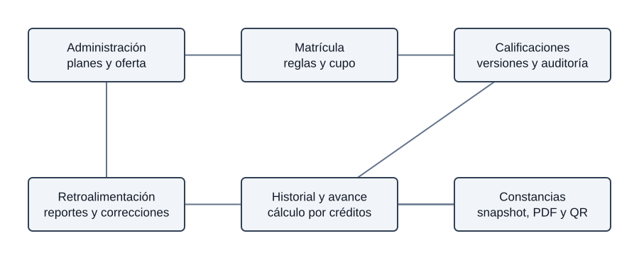
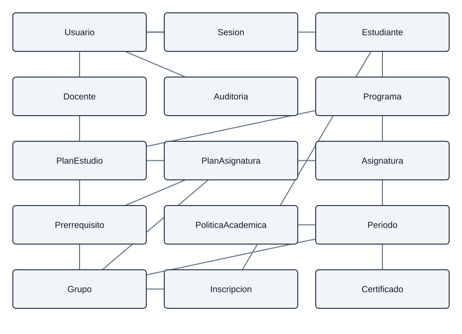
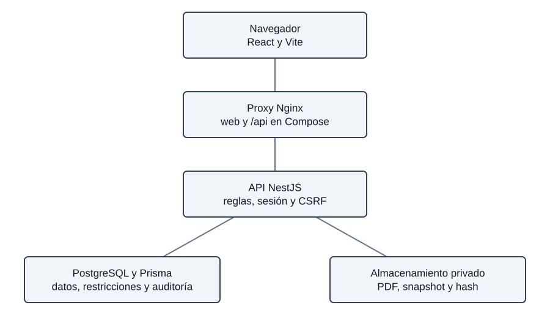

<div class="cover">
<p>UNIVERSIDAD AUTÓNOMA DEL ESTADO DE MÉXICO</p>
<p>UNIDAD ACADÉMICA PROFESIONAL TIANGUISTENCO</p>
<p>ASIGNATURA: INGENIERÍA DE SOFTWARE</p>
<p>GRUPO: C9</p>
<p>SISTEMA INTEGRAL DE GESTIÓN ACADÉMICA</p>
<p>INTEGRANTES DEL EQUIPO:</p>
<p>Abraham Eduardo Zavala Dehonor</p>
<p>Antonio Hernandez García</p>
<p>DOCENTE: ING. JOSAFAT MARTÍNEZ MARTÍNEZ</p>
<p>DICIEMBRE DE 2026</p>
</div>

# CONTENIDO

[[CONTENIDO]]

# INTRODUCCIÓN

El Sistema Integral de Gestión Académica (SIGA) integra información y procesos de inscripción, evaluación, seguimiento y emisión de constancias. El caso académico de CodeShift Empresarial permite estudiar cómo una organización de capacitación puede relacionar personas, programas, planes y grupos en una aplicación web con autorización por rol y conservación del historial.

El trabajo presenta el marco contextual, los fundamentos teóricos, el análisis y diseño, la implementación y las conclusiones. Se incluye un diccionario derivado del esquema de datos real, diagramas, resultados registrados, limitaciones y manuales de operación. Las tecnologías documentadas corresponden a la implementación: TypeScript, React/Vite, NestJS, Prisma y PostgreSQL.

El alcance es una demostración local con datos ficticios. Los resultados técnicos disponibles se distinguen de las pruebas pendientes y de la aceptación humana. El documento no presenta el prototipo como servicio institucional ni atribuye a participantes actividades que no están acreditadas. El corte técnico y documental de referencia es el 9 de noviembre de 2026; la fecha de portada sigue el periodo académico solicitado.

# RESUMEN

Se desarrolló SIGA como aplicación web para administrar programas y planes, estudiantes y docentes, periodos y grupos, inscripción, calificaciones, avance, constancias y reportes. Su diseño utiliza un monorepositorio TypeScript con React/Vite, NestJS, Prisma y PostgreSQL. La API valida sesión, rol y recurso; la matrícula combina restricciones y transacciones, y la corrección de notas emplea control de versión y auditoría. El historial calcula resultados por créditos y la constancia conserva una instantánea verificable mediante PDF, hash y código QR.

La revisión local del 9 de noviembre registró aprobación de lint, tipos, compilación y 38 pruebas API y 40 pruebas web. Los registros anteriores informan pruebas de integración, navegador, carga y restauración; sus límites se conservan explícitos. Persisten reservas en el instrumento de RPO, cobertura exigible, pruebas específicas de accesibilidad y sesión, trazabilidad del candidato y aceptación humana. Se entregan arquitectura, diccionario, evidencias indexadas y manuales completos dentro del informe. El resultado es una base funcional sustancial para demostración académica; su cierre integral requiere completar las comprobaciones y el piloto, sin añadir módulos fuera del alcance aprobado.

**Palabras clave:** gestión académica; aplicación web; integridad; trazabilidad; demostración local.

# ÍNDICE DE TABLAS

[[TABLAS]]

# ÍNDICE DE GRÁFICOS

[[GRAFICOS]]

# CAPÍTULO I. MARCO REFERENCIAL O CONTEXTUAL

## 1.1 Datos de la empresa

El Sistema Integral de Gestión Académica (SIGA) se presenta en el contexto académico de CodeShift Empresarial S.A. de C.V., organización descrita en el planteamiento original como proveedora de capacitación y actualización profesional en Toluca, Estado de México. Este nombre identifica el caso de estudio: el proyecto dispone de un cliente simulado y no aporta documentos que acrediten la existencia legal, la operación comercial o el diagnóstico presencial de una empresa real. Por tanto, las características organizacionales se conservan como contexto de diseño, no como resultados de una investigación empresarial de campo.

**Tabla 1. Caracterización del caso de estudio CodeShift.**

| Elemento                    | Descripción del caso académico                                                                                   |
| --------------------------- | ---------------------------------------------------------------------------------------------------------------- |
| Denominación                | CodeShift Empresarial S.A. de C.V.                                                                               |
| Giro planteado              | Capacitación y adiestramiento profesional para organizaciones y particulares.                                    |
| Ubicación de referencia     | Toluca, Estado de México.                                                                                        |
| Usuarios considerados       | Personal administrativo, instructores y participantes; en SIGA se denominan administrador, docente y estudiante. |
| Servicios representados     | Programas y planes de formación, asignaturas, grupos, inscripción, evaluación y expedición de constancias.       |
| Naturaleza de la validación | Simulación académica con datos ficticios y revisión del equipo y responsable académico.                          |

La misión propuesta consiste en apoyar el desarrollo de competencias mediante servicios de formación y capacitación. La visión del caso busca una organización reconocida por la calidad de sus instructores, la pertinencia de sus programas y la eficiencia de sus herramientas tecnológicas. Innovación, calidad, integridad y orientación al usuario son los valores que guían el diseño: se traducen en procesos comprensibles, datos consistentes, permisos explícitos y seguimiento de las modificaciones.

SIGA atiende la administración académica de esa organización. No administra su contabilidad, las relaciones laborales, el contenido didáctico de los cursos ni la acreditación oficial de programas. La distinción permite delimitar un producto realizable y explicar con precisión qué procesos intervienen en el caso de estudio.

## 1.2 Antecedentes

El informe inicial describe un centro de capacitación que pasa de atender grupos reducidos a gestionar varios programas, instructores y participantes. En ese escenario, la combinación de expedientes físicos, hojas de cálculo y archivos aislados dificulta mantener una versión común de la información. Una inscripción anotada en un archivo puede no reflejarse en el control de cupos; una nota corregida en otro puede no llegar al historial utilizado para elaborar una constancia.

Estos antecedentes constituyen la hipótesis operativa del proyecto. La antigüedad de ocho años y el crecimiento comercial mencionados en el documento original no se utilizan como hechos empresariales verificados, porque el repositorio no contiene documentación de campo que los sustente. El desarrollo se fundamenta en la necesidad académica de resolver el flujo descrito mediante un sistema integrado y comprobable.

Durante la construcción se organizó un monorepositorio con una aplicación web, una API y contratos compartidos. Posteriormente se incorporaron persistencia relacional, autorización, catálogos, oferta, matrícula, calificaciones, documentos y reportes. El plan maestro y su continuación descompusieron la entrega en bloques con criterios de verificación. Las auditorías posteriores identificaron la necesidad de separar tres estados: código disponible, comportamiento comprobado y aceptación humana. La existencia de un módulo o de una prueba automatizada no acredita por sí misma que usuarios reales hayan aprobado el sistema.

## 1.3 Definición del problema o problemática

El problema central del caso de estudio es la ausencia de una plataforma común que conserve y relacione la información del ciclo académico. La dispersión de datos obliga a repetir capturas y conciliaciones manuales; además, dificulta determinar quién puede modificar cada registro y cómo se reconstruye una decisión anterior.

### 1.3.1 Problemas identificados

**Tabla 2. Problemas del escenario y respuesta del sistema.**

| Problema del escenario                    | Riesgo o efecto esperado                                              | Respuesta de diseño en SIGA                                                      |
| ----------------------------------------- | --------------------------------------------------------------------- | -------------------------------------------------------------------------------- |
| Información personal y académica dispersa | Duplicidad e inconsistencias entre archivos.                          | Entidades relacionadas con identificadores, claves únicas y validaciones.        |
| Inscripción manual                        | Errores de cupo, duplicados y dependencia de una revisión individual. | Matrícula transaccional con comprobación de ventana, plan, requisitos y lugares. |
| Prerrequisitos revisados manualmente      | Inscripción sin antecedentes suficientes.                             | Grafo del plan y comparación con el historial aprobado.                          |
| Captura y cálculo separados               | Errores aritméticos y pérdida de correcciones.                        | Notas con versión, cálculo decimal y auditoría de cambios.                       |
| Escasa visibilidad del avance             | Consultas repetidas y dificultad para conocer pendientes.             | Historial y trayectoria accesibles para el estudiante autenticado.               |
| Elaboración manual de constancias         | Diferencias entre historial y documento emitido.                      | Instantánea de datos, PDF, huella de integridad y verificación por código.       |
| Permisos y cambios sin trazabilidad       | Lecturas o modificaciones indebidas.                                  | Sesiones, roles, autorización por recurso y bitácora.                            |

La tabla establece una relación de diseño. No representa una medición de ahorro, disminución de errores o satisfacción empresarial: esas conclusiones exigirían una comparación antes y después con participantes y datos observados.

### 1.3.2 Subsistemas afectados

El subsistema de estudiantes conserva identidad, plan e inscripciones. El de docentes relaciona al instructor con los grupos que puede consultar y calificar. El de asignaturas y oferta organiza programas, versiones de planes, seriación, periodos y cupos. El de calificaciones produce el historial y el avance utilizados por consultas, reportes y constancias.

La dependencia entre estos subsistemas explica la necesidad de una solución integral. La nota de una inscripción puede acreditar un prerrequisito; ese resultado modifica las posibilidades de una inscripción posterior. Una constancia, en cambio, debe conservar los datos que tenía al emitirse aunque más tarde cambie la información académica. El sistema necesita integrar los procesos y, simultáneamente, preservar el historial de sus salidas.

## 1.4 Justificación

La justificación operativa consiste en reducir capturas repetidas y aplicar reglas uniformes en los procesos de inscripción, evaluación y consulta. La automatización aporta una respuesta consistente ante situaciones que serían difíciles de coordinar manualmente, como dos solicitudes simultáneas para el último lugar de un grupo. El beneficio se expresa como capacidad implementada; no se cuantifica un ahorro de tiempo que no haya sido medido en un piloto.

Desde la perspectiva tecnológica, una base relacional permite expresar vínculos y restricciones entre estudiantes, grupos y planes. La API concentra las reglas de negocio y comprueba permisos independientemente de la pantalla utilizada. La separación entre presentación, servicios y persistencia facilita revisar el comportamiento y localizar las causas de un defecto.

Para los usuarios, disponer de consultas propias de matrícula, calificaciones y documentos disminuye la dependencia de archivos administrativos aislados. Esto no equivale a garantizar un portal productivo disponible las veinticuatro horas: la entrega evaluada es una demostración local, sujeta a las condiciones del equipo donde se ejecuta.

La selección de herramientas de código abierto evita depender de licencias comerciales para construir la demostración. Sin embargo, el proyecto no incluye un estudio financiero con cotizaciones, horas efectivas o retorno de inversión, por lo que no se afirma una rentabilidad comprobada. En el plano académico, el trabajo permite relacionar análisis, diseño, implementación, pruebas, operación y documentación con un mismo proceso de negocio.

## 1.5 Objetivos

### 1.5.1 Objetivo general

Desarrollar e implementar un sistema web integral de gestión académica para el caso de estudio CodeShift Empresarial que permita a los estudiantes inscribirse en cursos, consultar su progreso y obtener constancias de estudios; a los docentes registrar calificaciones de sus grupos; y a la administración gestionar personas, programas y oferta académica, con procesos verificables y una organización de trabajo orientada por Scrum y prácticas de Extreme Programming.

El objetivo conserva la intención del informe original y precisa el alcance de los documentos emitidos. La mención metodológica expresa el marco elegido; su aplicación histórica debe sustentarse con registros reales y no se deduce automáticamente de la existencia del software.

### 1.5.2 Objetivos específicos

1. Analizar el escenario y definir requisitos de usuarios, docentes, asignaturas, matrícula, calificaciones y documentos, manteniendo su identificación y trazabilidad.
2. Diseñar una aplicación web con responsabilidades separadas, un modelo relacional e interfaces diferenciadas para estudiante, docente y administrador.
3. Implementar inscripción con validación de prerrequisitos, cupos, pertenencia al plan y ventana del periodo, incluso ante solicitudes concurrentes.
4. Registrar notas finales y calcular promedios y avance con reglas académicas configurables, créditos históricos y control de cambios.
5. Generar constancias de estudios en PDF con código de verificación, consulta pública mínima y mecanismos de integridad, revocación y reemisión.
6. Verificar los procesos mediante pruebas pertinentes y preparar manuales y procedimientos de instalación, uso, respaldo y recuperación.

## 1.6 Alcance y limitaciones

### 1.6.1 Alcance

**Tabla 3. Delimitación funcional de la entrega.**

| Incluido                                                                   | Excluido de esta entrega                                              |
| -------------------------------------------------------------------------- | --------------------------------------------------------------------- |
| Portal web adaptable para estudiante, docente y administrador.             | Aplicación móvil nativa.                                              |
| Catálogos, personas, planes versionados, periodos y grupos.                | Contabilidad, pagos, colegiaturas y facturación.                      |
| Matrícula con requisitos, cupos y control transaccional.                   | Optimización de horarios y límites adicionales de carga no acordados. |
| Nota final, historial, promedio y avance por créditos.                     | Evaluaciones parciales y cancelación de autoservicio.                 |
| Constancias de estudios PDF, código, verificación, revocación y reemisión. | Firma electrónica avanzada, títulos o validez oficial.                |
| Reportes básicos, auditoría, sesiones y permisos.                          | LMS, tareas, videoclases e integraciones institucionales externas.    |
| Demostración local con datos sintéticos y documentación.                   | Publicación productiva remota y migración de expedientes reales.      |

### 1.6.2 Reglas provisionales de demostración

Las decisiones aceptadas para demostrar el alcance comprenden dos programas con datos sintéticos identificados como tales; escala de cero a diez, mínima aprobatoria de seis y dos decimales; promedio ponderado por créditos con todos los intentos calificados; y expedición de una constancia de estudios cuando exista al menos una nota final, incluidas asignaturas aprobadas y reprobadas. Las ventanas de inscripción utilizan como referencia la zona de Ciudad de México.

Estas decisiones se registran como reglas de demostración y no se presentan como reglamento de una institución. El mapa visual ICO-F19 tampoco acredita que esté cargado el catálogo oficial completo de claves, créditos y seriación. Los datos ficticios permiten verificar el flujo sin sustituir la autorización de un catálogo real.

### 1.6.3 Limitaciones y restricciones

El proyecto está limitado por el calendario académico, la disponibilidad del equipo y la infraestructura local. No dispone de validación empresarial de campo ni de una certificación de seguridad productiva. La provisión de accesos es un procedimiento separado del registro académico de personas. Los servicios externos, el correo opcional y la operación pública no son requisitos para concluir la demostración acordada.

La documentación y las pruebas automáticas constituyen evidencia técnica; la capacitación, el piloto, las ceremonias metodológicas y las firmas requieren intervención humana verificable. La auditoría vigente mantiene reservas de evidencia y operación, por lo que este informe no declara una aceptación integral inexistente.

# CAPÍTULO II. MARCO TEÓRICO

## 2.1 Sistema informático

Como referencia conceptual se conserva la obra de Laudon y Laudon (2020), incluida en la bibliografía original del proyecto.

### 2.1.1 Definición y componentes

Un sistema informático articula personas, procedimientos, datos, programas y equipos para transformar entradas en resultados útiles. La aplicación es solo uno de sus componentes: también intervienen la persona que configura una política, el docente que captura una nota y el responsable que conserva un respaldo. En SIGA, la información académica se almacena en PostgreSQL, las reglas se ejecutan en la API y los usuarios interactúan desde el navegador.

### 2.1.2 Importancia y tipos

Los sistemas de información permiten registrar operaciones y disponer de datos consistentes para la consulta. Un sistema transaccional protege operaciones concretas, como una inscripción; uno de apoyo a la gestión presenta resultados agregados, como un reporte. SIGA combina ambas funciones dentro de un alcance acotado: administra transacciones académicas y ofrece consultas básicas, sin convertirse en una plataforma analítica empresarial o un aula virtual.

La importancia del enfoque sistémico reside en comprender las consecuencias de cada cambio. Registrar una nota afecta el historial, el promedio, el avance y la elegibilidad futura. Una modificación debe conservar relaciones válidas entre esos resultados y respetar las salidas históricas ya emitidas.

## 2.2 Programación orientada a objetos

### 2.2.1 Definición y conceptos fundamentales

La programación orientada a objetos organiza software mediante entidades que reúnen estado y comportamiento. Una clase describe una estructura; una instancia representa un objeto concreto. Encapsular implica exponer operaciones controladas y mantener detalles internos dentro de una responsabilidad definida. Abstraer consiste en seleccionar los elementos relevantes del problema; la composición permite construir una capacidad mediante otras más pequeñas.

NestJS utiliza clases para controladores, servicios y proveedores. Un controlador recibe la petición y delega la operación; un servicio aplica reglas y coordina persistencia. La inyección de dependencias permite proporcionar a una clase los recursos que necesita sin que tenga que construirlos internamente. El modelo académico se expresa además mediante entidades relacionales y contratos tipados; no exige representar cada tabla como una jerarquía de herencia.

### 2.2.2 Ventajas y limitaciones

La separación de responsabilidades favorece la lectura y las pruebas. Por ejemplo, es posible revisar el cálculo académico sin mezclarlo con la presentación de una tabla. No obstante, introducir clases o capas para operaciones triviales incrementa la navegación y puede ocultar el flujo. El proyecto combina servicios orientados a objetos con funciones de cálculo y componentes funcionales de React según la responsabilidad de cada parte.

El uso de TypeScript no demuestra por sí mismo encapsulación correcta ni calidad de diseño. La mantenibilidad depende de interfaces claras, nombres consistentes, dependencias controladas y pruebas que comprueben reglas de negocio. Una estructura simple y verificable resulta más útil que una acumulación de patrones sin necesidad funcional.

## 2.3 TypeScript y JavaScript

### 2.3.1 Definición y ejecución

JavaScript es el lenguaje que ejecutan el navegador y Node.js. TypeScript incorpora anotaciones y comprobaciones estáticas sobre ese lenguaje; antes de la ejecución, el código se transforma a JavaScript. Los tipos ayudan a detectar contratos incompatibles durante la construcción, pero no sustituyen la validación de datos recibidos desde un formulario o una petición HTTP.

### 2.3.2 Aplicación en SIGA

El repositorio utiliza TypeScript en la API, en la interfaz y en los contratos compartidos. Esa elección facilita mantener conceptos comunes, como los roles o las estructuras de una respuesta, sin duplicar definiciones independientes. La API continúa siendo la autoridad para aceptar o rechazar una operación: una restricción del formulario mejora la experiencia, pero no protege el sistema frente a otras formas de invocar el servicio.

La programación asíncrona permite esperar consultas y operaciones de archivos sin bloquear todo el flujo del programa. Sin embargo, dos peticiones pueden competir por el mismo recurso. La concurrencia requiere transacciones y restricciones; utilizar promesas o esperar una función no garantiza por sí mismo que no haya sobrecupo o pérdida de una corrección.

### 2.3.3 Comunicación y manejo de errores

El navegador intercambia solicitudes HTTP y datos JSON con la API. Los contratos describen la información esperada, mientras las validaciones comprueban tipos, rangos y pertenencia de recursos. Los errores deben informar una condición recuperable sin exponer contraseñas, rutas internas ni detalles innecesarios de la base. Un conflicto de versión, por ejemplo, debe permitir actualizar la información antes de reintentar la captura.

## 2.4 PostgreSQL y Prisma

El modelo relacional se contextualiza con Elmasri y Navathe (2016); la descripción concreta de tablas y restricciones deriva del esquema local.

### 2.4.1 Modelo relacional

Una base relacional organiza información en tablas relacionadas por claves. Las claves primarias identifican registros; las foráneas exigen referencias existentes; las restricciones únicas impiden duplicados según el dominio. En SIGA, una inscripción no es solo la unión de identificadores válidos: estudiante, plan, grupo, asignatura, periodo y política deben pertenecer al mismo contexto académico.

PostgreSQL conserva esas relaciones y ejecuta transacciones. La atomicidad exige que una operación se confirme completa o se revierta; la consistencia mantiene las restricciones; el aislamiento controla interacciones concurrentes; y la durabilidad conserva lo confirmado. Estas propiedades no eliminan la necesidad de diseñar correctamente el proceso: el servicio debe bloquear y volver a comprobar los recursos relevantes dentro de la transacción.

### 2.4.2 Acceso mediante Prisma

Prisma permite describir modelos y generar un cliente tipado para consultar la base desde TypeScript. Las migraciones registran cambios del esquema para aplicarlos de forma controlada. El archivo declarativo no contiene toda la semántica: el proyecto también incorpora SQL con restricciones y disparadores que deben preservarse al evolucionar la estructura.

Las notas y los créditos utilizan valores decimales. Una calificación pendiente se representa sin nota; no debe confundirse con cero, que sí es una calificación posible. Los créditos de la inscripción se conservan como instantánea para que un cálculo histórico no cambie accidentalmente por una modificación posterior del catálogo.

### 2.4.3 Ventajas y compromisos

El modelo relacional facilita consultas relacionadas e integridad explícita. Prisma reduce errores de acceso y mantiene contratos de consulta, pero no reemplaza las restricciones persistentes ni el análisis de concurrencia. PostgreSQL exige administración, respaldos y migraciones; trabajar con contenedores simplifica el aislamiento, pero un volumen persistente continúa necesitando protección y un procedimiento de recuperación probado.

## 2.5 Herramientas de desarrollo

**Tabla 4. Herramientas y responsabilidad en el proyecto.**

| Herramienta               | Aplicación                                                                                                  |
| ------------------------- | ----------------------------------------------------------------------------------------------------------- |
| Node.js y npm             | Ejecución del backend, instalación reproducible mediante archivo de bloqueo y comandos del monorepositorio. |
| React y Vite              | Componentes de interfaz, desarrollo web y construcción del cliente.                                         |
| NestJS                    | Organización modular de controladores, servicios e infraestructura de API.                                  |
| PostgreSQL y Prisma       | Persistencia, cliente tipado y evolución del esquema.                                                       |
| Docker Compose y Nginx    | Entorno empaquetado local y acceso web a la API mediante proxy.                                             |
| Jest, Vitest y Playwright | Pruebas de servicios e integración, unidades web y recorridos de navegador.                                 |
| ESLint y Prettier         | Reglas estáticas de código y formato uniforme.                                                              |
| GitHub Actions            | Definición de automatizaciones del repositorio; su presencia no demuestra una ejecución remota concreta.    |

La herramienta de edición no determina la arquitectura del producto. El ejemplo académico de estructura menciona otros lenguajes, gestores y entornos; esos nombres se adaptan aquí a las tecnologías efectivamente presentes. No se documenta una instalación de Java, MySQL o NetBeans como requisito de SIGA.

La repetibilidad depende de conservar versiones, archivo de bloqueo, variables locales protegidas y procedimientos de instalación. Los archivos generados y los secretos no deben convertirse en requisitos ocultos de una copia limpia. La documentación técnica detalla los comandos y distingue la ejecución nativa de la modalidad con contenedores.

## 2.6 Aplicaciones web, enfoque sistémico, seguridad y pruebas

### 2.6.1 Arquitectura web

La arquitectura cliente-servidor distribuye responsabilidades entre navegador y servidor. SIGA utiliza una interfaz de una sola página que consulta una API; la API es un monolito modular, es decir, una aplicación desplegable organizada en módulos de negocio. Esta elección mantiene el despliegue sencillo para el alcance local y evita introducir servicios distribuidos sin una necesidad comprobada.

La presentación muestra formularios y resultados. Los servicios aplican reglas, autorizan recursos y coordinan transacciones. La persistencia conserva datos e integridad. Esta separación no significa que toda decisión exista en una sola capa: la interfaz puede anticipar errores para orientar al usuario y la base puede volver a proteger un vínculo crítico.

### 2.6.2 Teoría General de Sistemas

El enfoque de entradas, procesos, salidas y retroalimentación se vincula con Bertalanffy (1968).

La Teoría General de Sistemas permite observar entradas, procesos, salidas y retroalimentación. Para SIGA, las entradas incluyen programas, grupos, solicitudes y notas; los procesos son validación, inscripción, cálculo y emisión; las salidas incluyen historial, avance, reportes y constancias. La retroalimentación aparece cuando una nota habilita una asignatura posterior o cuando una corrección informa que debe revisarse una salida anterior.

Un ejemplo ilustra esa relación: el estudiante obtiene una nota aprobatoria, el historial registra el intento y el avance suma los créditos sin duplicarlos; la oferta puede reconocer el prerrequisito satisfecho. Si existe una constancia emitida, su PDF conserva la instantánea original. La corrección posterior debe auditarse y, cuando corresponda, tratar el documento mediante revocación y reemisión, en lugar de reescribir silenciosamente su contenido.

### 2.6.3 Seguridad de la información

La autenticación determina la identidad y la autorización determina las acciones permitidas. Además del rol, importa el recurso: un docente solo puede calificar los grupos que tiene asignados y un estudiante consulta su información privada. Ocultar un botón no constituye autorización; la API debe comprobar cada operación protegida.

El proyecto utiliza hashes de contraseñas, sesiones contrastadas con la base y cookies HttpOnly y SameSite. Las operaciones de cambio requieren protección CSRF y comprobaciones de origen según el flujo implementado. El almacenamiento de secretos en archivos locales ignorados y el uso de un rol restringido de base disminuyen exposición accidental. Estas medidas son parte del diseño local y no constituyen una certificación de seguridad ni una declaración de cumplimiento normativo productivo.

### 2.6.4 Calidad y pruebas

Una prueba unitaria comprueba una responsabilidad acotada; una prueba de integración ejercita componentes con infraestructura real; una prueba de extremo a extremo reproduce un recorrido desde el navegador. Las pruebas de concurrencia examinan operaciones simultáneas y las de carga observan tiempo y errores bajo un escenario definido. Cada resultado tiene un alcance y depende del código, datos y entorno utilizados.

La cobertura indica qué código se ejecutó durante una batería; no demuestra ausencia de defectos. Del mismo modo, una simulación de zoom CSS no equivale a verificar el zoom real del navegador y un intervalo medido antes de un respaldo no demuestra por sí mismo la pérdida de datos ante un incidente. Por ello la auditoría conserva reservas cuando el instrumento no corresponde al criterio que se pretende acreditar.

### 2.6.5 Constancias y verificación

Una constancia electrónica es una salida académica generada a partir de datos del sistema. SIGA utiliza un código de verificación, una instantánea y una huella SHA-256 del archivo emitido. El código permite consultar un estado público con información mínima, mientras la huella permite detectar alteraciones del archivo conservado. La existencia de un código o un QR no otorga automáticamente validez oficial.

El único tipo de documento del alcance es la constancia de estudios de demostración. No acredita necesariamente la terminación del plan, porque la regla aceptada permite emitirla con al menos una nota final y mostrar materias aprobadas y reprobadas. Su autenticidad dentro de SIGA debe distinguirse de la firma electrónica avanzada y del reconocimiento por una autoridad externa.

# CAPÍTULO III. DISEÑO Y DESARROLLO

## 3.1 Metodología

Las referencias metodológicas son Schwaber y Sutherland (2020) y Beck y Andres (2004). Se distinguen de la evidencia de ejecución real del proyecto.

El informe original propone Scrum como marco de organización y Extreme Programming como referencia de prácticas técnicas. Scrum aporta priorización, trabajo iterativo y revisión; XP orienta hacia pruebas, diseño simple, integración y mejora continua. La elección es pertinente para construir incrementos pequeños y revisar reglas académicas progresivamente.

La reconstrucción realizada en esta entrega se basa en los archivos disponibles. Se observan planes por etapas, backlog, decisiones, pruebas y automatizaciones. Esos artefactos permiten describir una construcción incremental y una estrategia técnica de verificación. No permiten demostrar por sí mismos que se celebraron reuniones concretas, que se trabajó en parejas humanas o que cada prueba se escribió antes que el código. Los registros metodológicos y su validación continúan como una obligación de aceptación humana cuando no exista evidencia suficiente.

**Tabla 5. Marco metodológico y evidencia exigible.**

| Elemento                  | Aplicación documentada o prevista                                | Límite de la afirmación                                                    |
| ------------------------- | ---------------------------------------------------------------- | -------------------------------------------------------------------------- |
| Backlog y etapas          | Plan maestro, continuación y entregas funcionales identificadas. | El archivo de planificación no prueba una reunión.                         |
| Revisión de requisitos    | Decisiones y criterios vinculados con código y pruebas.          | Las reglas de demostración no equivalen a reglamento institucional.        |
| Calidad técnica           | Suites, análisis estático y comandos de verificación.            | Un resultado solo respalda el candidato y escenario registrados.           |
| Scrum                     | Roles y eventos propuestos en el informe inicial.                | Actas, participantes y aceptación requieren registros reales.              |
| XP                        | Pruebas, refactorización e integración presentes.                | TDD histórico y parejas no se acreditan retrospectivamente por inferencia. |
| Capacitación y aceptación | Guiones, manuales y dossier preparados.                          | La ejecución con personas y las firmas permanecen separadas.               |

Los roles personales consignados en el documento inicial son una propuesta organizativa del trabajo académico y no una certificación de que cada responsabilidad se ejecutó. La coordinación mediante herramientas y agentes de apoyo tampoco sustituye la revisión del equipo ni la conformidad del responsable académico.

## 3.2 Recolección de la información

La fuente principal de esta revisión es documental: informe original, estructura solicitada, indicaciones de presentación, plan maestro, decisiones, backlog, modelos, código y evidencias del repositorio. Se contrastaron nombres, relaciones y procesos con el esquema Prisma y la documentación de arquitectura. No se registran entrevistas, encuestas, observaciones de una empresa ni mediciones con usuarios que no estén respaldadas por instrumentos y participantes identificables.

### 3.2.1 Alcance del análisis

Se sigue el recorrido desde la preparación de catálogos y personas hasta la emisión y consulta de una constancia. La revisión incluye acceso por roles, consistencia académica, conservación del historial y operación local. Se distinguen funciones implementadas de comprobaciones pendientes; las necesidades ajenas a la demostración se mantienen fuera de alcance.

La entrega documental adapta los ejemplos tecnológicos de la estructura institucional. Conserva los apartados de contexto, teoría, diseño, implementación, conclusiones y anexos, pero desarrolla el contenido con la aplicación real. También elimina la hoja de instrucciones y los textos de ejemplo ajenos a SIGA del cuerpo del trabajo.

### 3.2.2 Análisis de procesos

El proceso comienza cuando la administración prepara programas, planes, asignaturas, personas, periodos y grupos. El alta de una persona crea su relación académica, pero el acceso requiere una provisión de credenciales independiente. El estudiante autenticado consulta la oferta de su plan y solicita una inscripción. El servicio verifica estado, fechas, requisitos y cupo dentro del proceso protegido.

Posteriormente, el docente asignado registra la nota final de la inscripción. El cálculo académico utiliza notas calificadas y créditos históricos; diferencia pendientes, aprobaciones y reintentos. El estudiante consulta los resultados y solicita una constancia cuando cumple la regla de demostración. La emisión conserva su instantánea, genera el archivo y registra su integridad. La administración dispone de reportes y de operaciones controladas de revocación o reemisión.

### 3.2.3 Estudio de factibilidad

**Tabla 6. Factibilidad del alcance académico local.**

| Dimensión          | Evaluación razonada                                                                         | Condición o restricción                                                                      |
| ------------------ | ------------------------------------------------------------------------------------------- | -------------------------------------------------------------------------------------------- |
| Técnica            | Existe una arquitectura implementada con herramientas disponibles y procedimientos locales. | Requiere versiones compatibles, base preparada y verificación del candidato final.           |
| Operativa          | Los tres perfiles tienen recorridos y materiales de uso.                                    | La facilidad de uso debe confirmarse en un piloto humano.                                    |
| Económica          | El desarrollo no exige licencias comerciales de los componentes principales.                | No hay presupuesto validado ni estudio de rentabilidad; equipo y mantenimiento tienen costo. |
| Temporal           | El trabajo se organiza en entregas y criterios identificados.                               | El calendario del curso limita nuevas funciones y exige priorizar defectos del alcance.      |
| Datos y privacidad | La demostración puede ejecutarse con datos ficticios.                                       | No autoriza importar expedientes reales ni publicar credenciales.                            |
| Académica          | La estructura permite presentar requisitos, diseño, pruebas y manuales.                     | La aceptación, metodología y firmas dependen de evaluación humana.                           |

La conclusión de factibilidad se limita a continuar y demostrar el producto local. No acredita capacidad de una infraestructura pública ni una contratación empresarial. Antes de operar con información real se requeriría otra evaluación de seguridad, disponibilidad, privacidad, soporte y autoridad sobre las reglas académicas.

### 3.2.4 Análisis de los requerimientos

Los requisitos se agrupan en funcionales, reglas de negocio y atributos no funcionales. Su referencia detallada se conserva en la matriz de trazabilidad del repositorio, junto con los identificadores RF, RN y RNF existentes. La tabla siguiente resume familias para lectura del informe; no crea nuevos requisitos ni sustituye dicha matriz.

**Tabla 7. Familias de requerimientos y criterio de diseño.**

| Familia              | Necesidad                                                      | Criterio observable                                                |
| -------------------- | -------------------------------------------------------------- | ------------------------------------------------------------------ |
| Identidad y acceso   | Iniciar y cerrar sesión con permisos apropiados.               | Rechazo de sesión inválida y de operaciones sobre recursos ajenos. |
| Catálogos y personas | Administrar datos y conservar referencias históricas.          | Validación de claves y bajas lógicas sin eliminar historial.       |
| Plan y oferta        | Relacionar versión, asignaturas, seriación, periodos y grupos. | Rechazo de ciclos y combinaciones académicas incompatibles.        |
| Matrícula            | Inscribir solo cuando se satisfacen reglas y hay lugar.        | Ausencia de duplicados y protección del último cupo concurrente.   |
| Evaluación           | Registrar y corregir nota final con trazabilidad.              | Precisión válida, control de versión y auditoría del cambio.       |
| Consulta académica   | Presentar historial, promedio y avance.                        | Cálculo consistente con política e instantánea de créditos.        |
| Documentos           | Emitir y verificar una constancia de estudios.                 | Instantánea, archivo íntegro y estado de emisión o revocación.     |
| Operación y calidad  | Instalar, respaldar y verificar el sistema.                    | Procedimientos reproducibles y evidencias con sus límites.         |

La política provisional usa promedio ponderado: la suma de cada nota multiplicada por sus créditos se divide entre la suma de créditos de los intentos calificados incluidos. Si no existen intentos aplicables, no se inventa una nota de cero. El avance suma una sola vez los créditos de cada asignatura aprobada y debe tratar de forma explícita un plan sin créditos. Las condiciones de una política se conservan versionadas para interpretar los intentos históricos.

### 3.2.5 Definición de casos de uso

**Tabla 8. Casos de uso principales por actor.**

| Actor         | Caso de uso              | Precondición                                         | Resultado esperado                                                  |
| ------------- | ------------------------ | ---------------------------------------------------- | ------------------------------------------------------------------- |
| Administrador | Preparar catálogo y plan | Sesión administrativa activa.                        | Estructura válida sin ciclos y con versión identificable.           |
| Administrador | Registrar personas       | Datos válidos y claves disponibles.                  | Perfil y cuenta relacionados; acceso tratado por separado.          |
| Administrador | Abrir oferta             | Plan, asignatura, docente y periodo compatibles.     | Grupo disponible con cupo y política definidos.                     |
| Estudiante    | Inscribirse en grupo     | Perfil activo, oferta elegible y ventana vigente.    | Inscripción única y auditada o rechazo sin cambios parciales.       |
| Docente       | Capturar nota final      | Asignación al grupo y versión vigente.               | Nota válida persistida junto con su auditoría.                      |
| Estudiante    | Consultar avance         | Sesión del titular.                                  | Historial y cálculos de su propia trayectoria.                      |
| Estudiante    | Solicitar constancia     | Al menos una nota final según regla de demostración. | Emisión con instantánea y archivo o estado recuperable de fallo.    |
| Público       | Verificar código         | Código conocido de una constancia.                   | Estado e información pública mínima.                                |
| Administrador | Revocar o reemitir       | Documento elegible y motivo cuando corresponde.      | Conservación del documento previo y trazabilidad de la sustitución. |

En matrícula, el flujo alternativo puede ser cupo agotado, requisito no satisfecho, duplicado o ventana cerrada. La oferta orienta al estudiante, pero el servidor vuelve a comprobar las reglas al recibir la solicitud. En calificaciones, una versión obsoleta provoca conflicto en lugar de sobrescribir un cambio ajeno. En emisión, un fallo entre base y archivo exige recuperación y conciliación; no debe resolverse mediante borrados indiscriminados.

## 3.3 Diseño

### 3.3.1 Diseño conceptual



Gráfico 1. Entradas, procesos, salidas y retroalimentación del SIGA.

El concepto central es la trayectoria de un estudiante dentro de una versión de plan. Un programa dispone de planes; cada plan incorpora asignaturas con créditos y relaciones de prerrequisito. Un periodo aplica una política y ofrece grupos para asignaturas del plan. El grupo pertenece a un docente y recibe inscripciones de estudiantes compatibles con ese plan.

La identidad de acceso se separa del perfil académico. Usuario conserva correo, hash, rol y estado; Estudiante o Docente agregan sus datos específicos. Sesion permite controlar vigencia y revocación. Esta separación evita confundir una baja o modificación académica con una concesión de credenciales.

La inscripción reúne el contexto histórico: estudiante, grupo, asignatura, plan, periodo, política, estado, nota y créditos. Certificado conserva la salida emitida, su instantánea y su archivo; Auditoria registra acciones relevantes y valores anteriores o posteriores. El diseño mantiene restricciones de eliminación para proteger relaciones e historial.

### 3.3.2 Modelo relacional



Gráfico 2. Relaciones principales de los quince modelos de dominio. Las claves y cardinalidades se detallan en el esquema y el diccionario.

El esquema Prisma describe quince modelos de dominio; con la tabla interna de migraciones se contabilizan dieciséis tablas. Sus relaciones se complementan con restricciones y disparadores SQL. Las asociaciones de muchos a muchos se representan explícitamente cuando contienen datos del dominio: PlanAsignatura agrega créditos y semestre sugerido; Prerrequisito expresa una arista dentro del mismo plan.

**Tabla 9. Entidades y relaciones principales del modelo.**

| Entidad           | Responsabilidad                         | Relación principal                           |
| ----------------- | --------------------------------------- | -------------------------------------------- |
| Usuario           | Identidad de acceso y rol.              | Sesiones, perfil y actor de auditoría.       |
| Sesion            | Vigencia y revocación del acceso.       | Pertenece a un usuario.                      |
| Programa          | Catálogo de programas.                  | Contiene versiones de planes.                |
| PlanEstudio       | Versión de estructura académica.        | Programa, asignaturas y estudiantes.         |
| Estudiante        | Perfil académico del participante.      | Usuario, plan, inscripciones y constancias.  |
| Docente           | Perfil del instructor.                  | Usuario y grupos asignados.                  |
| Asignatura        | Identidad de unidad de aprendizaje.     | Participa en distintos planes.               |
| PlanAsignatura    | Configuración de asignatura en plan.    | Créditos, seriación y grupos.                |
| Prerrequisito     | Dependencia entre asignaturas del plan. | Origen requerido y destino.                  |
| PoliticaAcademica | Escala y reglas versionadas.            | Aplicación mediante periodos.                |
| Periodo           | Calendario y ventana de inscripción.    | Política y grupos.                           |
| Grupo             | Oferta con docente y cupo.              | Asignatura del plan e inscripciones.         |
| Inscripcion       | Intento académico y resultado.          | Estudiante y contexto íntegro del grupo.     |
| Certificado       | Constancia, estado e integridad.        | Estudiante y eventual documento reemplazado. |
| Auditoria         | Trazabilidad aditiva de acciones.       | Actor opcional y recurso identificado.       |

Las claves compuestas impiden combinar una inscripción con un plan ajeno al estudiante o un contexto distinto del grupo. La unicidad de estudiante, asignatura y periodo protege contra duplicación entre grupos. Las referencias de tipo Restrict evitan eliminaciones en cascada sobre el historial. Los estados se representan con enumeraciones explícitas, por ejemplo PENDIENTE y CALIFICADA para inscripción, y PENDIENTE, EMITIDO, REVOCADO o FALLIDO para constancia.

El control de concurrencia combina restricciones, transacciones serializables y bloqueos con orden consistente. La nota utiliza una versión para detectar ediciones sobre información obsoleta. Estas decisiones responden a fallos concretos del dominio y no se sustituyen con validaciones solo en el navegador.

## 3.4 Diccionario de datos

El diccionario siguiente describe por entidad los campos, tipos, nulabilidad, valores iniciales y claves declaradas en el esquema real `apps/api/prisma/schema.prisma`. El esquema y las migraciones constituyen la referencia técnica para contrastarlo; la extracción automática evita transcribir nombres incompatibles con la aplicación.

La lectura del diccionario requiere distinguir tipos de aplicación y tipos de almacenamiento. Un identificador String puede almacenarse como UUID; DateTime puede corresponder a fecha o instante con zona; Decimal conserva precisión definida; Json permite almacenar una instantánea estructurada. Un campo opcional no necesariamente carece de regla: la nota solo procede en estados compatibles y una emisión exige datos de archivo que no existen mientras está pendiente.

Además de la descripción por campo deben conservarse las garantías transversales: correo y claves normalizados, créditos positivos, coherencia de ventanas, ausencia de ciclos, relación del estudiante con su plan, integridad del grupo y protección de auditoría. Algunas residen en SQL o servicios, por lo que no deben atribuirse de manera exclusiva al archivo Prisma.

### 3.4.1 Entidad Usuario

| Campo         | Tipo y nulabilidad        | Restricción declarada                              |
| ------------- | ------------------------- | -------------------------------------------------- |
| id            | String / Uuid             | Clave primaria; Valor inicial definido en esquema. |
| correo        | String / VarChar(254)     | Único.                                             |
| passwordHash  | String / Text             | Hash privado; no exponer.                          |
| rol           | Rol                       | Validar contrato y relaciones del modelo.          |
| activo        | Boolean                   | Valor inicial definido en esquema.                 |
| creadoEn      | DateTime / Timestamptz(3) | Valor inicial definido en esquema.                 |
| actualizadoEn | DateTime / Timestamptz(3) | Actualización automática.                          |

Restricciones e índices compuestos: no se declaran adicionales en este modelo.

### 3.4.2 Entidad Sesion

| Campo      | Tipo y nulabilidad         | Restricción declarada                              |
| ---------- | -------------------------- | -------------------------------------------------- |
| id         | String / Uuid              | Clave primaria; Valor inicial definido en esquema. |
| usuarioId  | String / Uuid              | Validar contrato y relaciones del modelo.          |
| creadoEn   | DateTime / Timestamptz(3)  | Valor inicial definido en esquema.                 |
| expiraEn   | DateTime / Timestamptz(3)  | Validar contrato y relaciones del modelo.          |
| revocadaEn | DateTime? / Timestamptz(3) | Validar contrato y relaciones del modelo.          |

Restricciones e índices compuestos: `@@index([usuarioId, expiraEn])`.

### 3.4.3 Entidad Programa

| Campo  | Tipo y nulabilidad    | Restricción declarada                              |
| ------ | --------------------- | -------------------------------------------------- |
| id     | String / Uuid         | Clave primaria; Valor inicial definido en esquema. |
| clave  | String / VarChar(40)  | Único.                                             |
| nombre | String / VarChar(160) | Validar contrato y relaciones del modelo.          |
| activo | Boolean               | Valor inicial definido en esquema.                 |

Restricciones e índices compuestos: no se declaran adicionales en este modelo.

### 3.4.4 Entidad PlanEstudio

| Campo      | Tipo y nulabilidad    | Restricción declarada                              |
| ---------- | --------------------- | -------------------------------------------------- |
| id         | String / Uuid         | Clave primaria; Valor inicial definido en esquema. |
| programaId | String / Uuid         | Validar contrato y relaciones del modelo.          |
| version    | Int                   | Versión de entidad o edición según modelo.         |
| nombre     | String / VarChar(160) | Validar contrato y relaciones del modelo.          |
| activo     | Boolean               | Valor inicial definido en esquema.                 |
| revision   | Int                   | Valor inicial definido en esquema.                 |

Restricciones e índices compuestos: `@@unique([programaId, version])`.

### 3.4.5 Entidad Estudiante

| Campo        | Tipo y nulabilidad    | Restricción declarada                              |
| ------------ | --------------------- | -------------------------------------------------- |
| id           | String / Uuid         | Clave primaria; Valor inicial definido en esquema. |
| usuarioId    | String / Uuid         | Único.                                             |
| matricula    | String / VarChar(40)  | Único.                                             |
| nombre       | String / VarChar(160) | Validar contrato y relaciones del modelo.          |
| planId       | String / Uuid         | Validar contrato y relaciones del modelo.          |
| fechaIngreso | DateTime / Date       | Validar contrato y relaciones del modelo.          |
| estado       | EstadoEstudiante      | Valor inicial definido en esquema.                 |

Restricciones e índices compuestos: `@@unique([id, planId])`; `@@index([planId])`.

### 3.4.6 Entidad Docente

| Campo          | Tipo y nulabilidad    | Restricción declarada                              |
| -------------- | --------------------- | -------------------------------------------------- |
| id             | String / Uuid         | Clave primaria; Valor inicial definido en esquema. |
| usuarioId      | String / Uuid         | Único.                                             |
| numeroEmpleado | String / VarChar(40)  | Único.                                             |
| nombre         | String / VarChar(160) | Validar contrato y relaciones del modelo.          |
| departamento   | String / VarChar(160) | Validar contrato y relaciones del modelo.          |
| activo         | Boolean               | Valor inicial definido en esquema.                 |

Restricciones e índices compuestos: no se declaran adicionales en este modelo.

### 3.4.7 Entidad Asignatura

| Campo  | Tipo y nulabilidad    | Restricción declarada                              |
| ------ | --------------------- | -------------------------------------------------- |
| id     | String / Uuid         | Clave primaria; Valor inicial definido en esquema. |
| clave  | String / VarChar(40)  | Único.                                             |
| nombre | String / VarChar(160) | Validar contrato y relaciones del modelo.          |
| activo | Boolean               | Valor inicial definido en esquema.                 |

Restricciones e índices compuestos: no se declaran adicionales en este modelo.

### 3.4.8 Entidad PlanAsignatura

| Campo            | Tipo y nulabilidad      | Restricción declarada                     |
| ---------------- | ----------------------- | ----------------------------------------- |
| planId           | String / Uuid           | Validar contrato y relaciones del modelo. |
| asignaturaId     | String / Uuid           | Validar contrato y relaciones del modelo. |
| creditos         | Decimal / Decimal(8, 2) | Validar contrato y relaciones del modelo. |
| semestreSugerido | Int                     | Validar contrato y relaciones del modelo. |

Restricciones e índices compuestos: `@@id([planId, asignaturaId])`; `@@index([asignaturaId])`.

### 3.4.9 Entidad Prerrequisito

| Campo        | Tipo y nulabilidad | Restricción declarada                     |
| ------------ | ------------------ | ----------------------------------------- |
| planId       | String / Uuid      | Validar contrato y relaciones del modelo. |
| asignaturaId | String / Uuid      | Validar contrato y relaciones del modelo. |
| requeridaId  | String / Uuid      | Validar contrato y relaciones del modelo. |

Restricciones e índices compuestos: `@@id([planId, asignaturaId, requeridaId])`; `@@index([planId, requeridaId])`.

### 3.4.10 Entidad PoliticaAcademica

| Campo                        | Tipo y nulabilidad        | Restricción declarada                              |
| ---------------------------- | ------------------------- | -------------------------------------------------- |
| id                           | String / Uuid             | Clave primaria; Valor inicial definido en esquema. |
| version                      | String / VarChar(60)      | Único; Versión de entidad o edición según modelo.  |
| descripcion                  | String / Text             | Validar contrato y relaciones del modelo.          |
| escalaMinima                 | Decimal / Decimal(7, 3)   | Validar contrato y relaciones del modelo.          |
| escalaMaxima                 | Decimal / Decimal(7, 3)   | Validar contrato y relaciones del modelo.          |
| minimaAprobatoria            | Decimal / Decimal(7, 3)   | Validar contrato y relaciones del modelo.          |
| decimales                    | Int                       | Validar contrato y relaciones del modelo.          |
| intentosPromedio             | PoliticaIntentos          | Validar contrato y relaciones del modelo.          |
| permiteReinscripcionAprobada | Boolean                   | Valor inicial definido en esquema.                 |
| permiteCancelacionEstudiante | Boolean                   | Valor inicial definido en esquema.                 |
| esPropuesta                  | Boolean                   | Valor inicial definido en esquema.                 |
| creadoEn                     | DateTime / Timestamptz(3) | Valor inicial definido en esquema.                 |

Restricciones e índices compuestos: no se declaran adicionales en este modelo.

### 3.4.11 Entidad Periodo

| Campo             | Tipo y nulabilidad        | Restricción declarada                              |
| ----------------- | ------------------------- | -------------------------------------------------- |
| id                | String / Uuid             | Clave primaria; Valor inicial definido en esquema. |
| clave             | String / VarChar(40)      | Único.                                             |
| nombre            | String / VarChar(160)     | Validar contrato y relaciones del modelo.          |
| inicio            | DateTime / Date           | Validar contrato y relaciones del modelo.          |
| fin               | DateTime / Date           | Validar contrato y relaciones del modelo.          |
| inscripcionInicio | DateTime / Timestamptz(3) | Validar contrato y relaciones del modelo.          |
| inscripcionFin    | DateTime / Timestamptz(3) | Validar contrato y relaciones del modelo.          |
| estado            | EstadoPeriodo             | Valor inicial definido en esquema.                 |
| politicaId        | String / Uuid             | Validar contrato y relaciones del modelo.          |

Restricciones e índices compuestos: `@@unique([id, politicaId])`.

### 3.4.12 Entidad Grupo

| Campo        | Tipo y nulabilidad   | Restricción declarada                              |
| ------------ | -------------------- | -------------------------------------------------- |
| id           | String / Uuid        | Clave primaria; Valor inicial definido en esquema. |
| clave        | String / VarChar(40) | Validar contrato y relaciones del modelo.          |
| planId       | String / Uuid        | Validar contrato y relaciones del modelo.          |
| asignaturaId | String / Uuid        | Validar contrato y relaciones del modelo.          |
| periodoId    | String / Uuid        | Validar contrato y relaciones del modelo.          |
| politicaId   | String / Uuid        | Validar contrato y relaciones del modelo.          |
| docenteId    | String / Uuid        | Validar contrato y relaciones del modelo.          |
| cupo         | Int                  | Validar contrato y relaciones del modelo.          |
| activo       | Boolean              | Valor inicial definido en esquema.                 |

Restricciones e índices compuestos: `@@unique([periodoId, clave])`; `@@unique([id, planId, asignaturaId, periodoId, politicaId])`; `@@index([planId, asignaturaId])`; `@@index([periodoId, politicaId])`; `@@index([docenteId, periodoId])`.

### 3.4.13 Entidad Inscripcion

| Campo            | Tipo y nulabilidad        | Restricción declarada                                                         |
| ---------------- | ------------------------- | ----------------------------------------------------------------------------- |
| id               | String / Uuid             | Clave primaria; Valor inicial definido en esquema.                            |
| estudianteId     | String / Uuid             | Validar contrato y relaciones del modelo.                                     |
| planId           | String / Uuid             | Validar contrato y relaciones del modelo.                                     |
| grupoId          | String / Uuid             | Validar contrato y relaciones del modelo.                                     |
| asignaturaId     | String / Uuid             | Validar contrato y relaciones del modelo.                                     |
| periodoId        | String / Uuid             | Validar contrato y relaciones del modelo.                                     |
| politicaId       | String / Uuid             | Validar contrato y relaciones del modelo.                                     |
| estado           | EstadoInscripcion         | Valor inicial definido en esquema.                                            |
| notaFinal        | Decimal? / Decimal(7, 3)  | Pendiente distinto de cero; escala por política.                              |
| creditosSnapshot | Decimal / Decimal(8, 2)   | Validar contrato y relaciones del modelo.                                     |
| creadoEn         | DateTime / Timestamptz(3) | Valor inicial definido en esquema.                                            |
| actualizadoEn    | DateTime / Timestamptz(3) | Actualización automática.                                                     |
| version          | Int                       | Valor inicial definido en esquema; Versión de entidad o edición según modelo. |

Restricciones e índices compuestos: `@@unique([estudianteId, asignaturaId, periodoId])`; `@@index([grupoId, planId, asignaturaId, periodoId, politicaId])`; `@@index([estudianteId, planId])`; `@@index([periodoId, estado])`.

### 3.4.14 Entidad Certificado

| Campo            | Tipo y nulabilidad         | Restricción declarada                              |
| ---------------- | -------------------------- | -------------------------------------------------- |
| id               | String / Uuid              | Clave primaria; Valor inicial definido en esquema. |
| estudianteId     | String / Uuid              | Validar contrato y relaciones del modelo.          |
| tipo             | TipoCertificado            | Valor inicial definido en esquema.                 |
| codigo           | String / VarChar(32)       | Único; Valor inicial definido en esquema.          |
| estado           | EstadoCertificado          | Valor inicial definido en esquema.                 |
| solicitadoEn     | DateTime / Timestamptz(3)  | Valor inicial definido en esquema.                 |
| emitidoEn        | DateTime? / Timestamptz(3) | Validar contrato y relaciones del modelo.          |
| instantanea      | Json                       | Validar contrato y relaciones del modelo.          |
| archivoRuta      | String? / Text             | Validar contrato y relaciones del modelo.          |
| archivoSha256    | String? / VarChar(64)      | Validar contrato y relaciones del modelo.          |
| revocadoEn       | DateTime? / Timestamptz(3) | Validar contrato y relaciones del modelo.          |
| motivoRevocacion | String? / Text             | Validar contrato y relaciones del modelo.          |
| reemplazaId      | String? / Uuid             | Único.                                             |

Restricciones e índices compuestos: `@@index([estudianteId, solicitadoEn])`.

### 3.4.15 Entidad Auditoria

| Campo     | Tipo y nulabilidad        | Restricción declarada                              |
| --------- | ------------------------- | -------------------------------------------------- |
| id        | String / Uuid             | Clave primaria; Valor inicial definido en esquema. |
| actorId   | String? / Uuid            | Validar contrato y relaciones del modelo.          |
| accion    | String / VarChar(80)      | Validar contrato y relaciones del modelo.          |
| recurso   | String / VarChar(80)      | Validar contrato y relaciones del modelo.          |
| recursoId | String / VarChar(100)     | Validar contrato y relaciones del modelo.          |
| motivo    | String? / Text            | Validar contrato y relaciones del modelo.          |
| anterior  | Json?                     | Validar contrato y relaciones del modelo.          |
| posterior | Json?                     | Validar contrato y relaciones del modelo.          |
| creadoEn  | DateTime / Timestamptz(3) | Valor inicial definido en esquema.                 |

Restricciones e índices compuestos: `@@index([recurso, recursoId, creadoEn])`; `@@index([actorId, creadoEn])`.

## 3.5 Diseño de interfaces

### 3.5.1 Organización por perfil

La portada permite iniciar sesión y presenta el carácter general del sistema. Tras autenticarse, el usuario accede al espacio de su rol. El estudiante dispone de matrícula, calificaciones, trayectoria y constancias; el docente consulta sus grupos y captura notas; la administración opera catálogos, personas, oferta, documentos y reportes. Los nombres del dominio se mantienen en español para facilitar la relación entre pantallas y procesos académicos.

**Tabla 10. Pantallas y finalidad de interacción.**

| Perfil        | Interfaz                     | Información y acción principal                                        |
| ------------- | ---------------------------- | --------------------------------------------------------------------- |
| Común         | Acceso y sesión              | Identidad, errores comprensibles y cierre de sesión.                  |
| Estudiante    | Matrícula                    | Oferta elegible, lugares, motivos de rechazo e inscripciones propias. |
| Estudiante    | Calificaciones y trayectoria | Historial, promedio, créditos y progreso.                             |
| Estudiante    | Constancias                  | Solicitud, estado y descarga autorizada.                              |
| Docente       | Grupos y captura             | Lista propia, alumnos y edición de nota final.                        |
| Administrador | Catálogos y personas         | Búsqueda, alta, edición y consulta de archivados.                     |
| Administrador | Periodos y grupos            | Calendario, ventana, política, docente y cupo.                        |
| Administrador | Documentos y reportes        | Consulta, filtros, revocación y exportación permitida.                |
| Público       | Verificación                 | Consulta mínima del estado mediante código.                           |

### 3.5.2 Validación y retroalimentación

Las interfaces distinguen carga, ausencia de resultados, error y éxito. Los formularios orientan sobre campos y muestran rechazos del servidor sin simular que se guardó una operación fallida. Las listas requieren búsqueda y paginación para que el acceso a datos no dependa de que todos los registros quepan en una primera página.

La captura de notas exige especial cuidado con borradores y conflictos. Cada fila puede contener una modificación pendiente; un fallo parcial no debe presentar todas las filas como guardadas. Una respuesta tardía de una sesión anterior debe descartarse para evitar mezclar información privada entre personas que usan el mismo navegador. Estas propiedades se revisan tanto en el comportamiento del cliente como en las pruebas de integración del flujo.

### 3.5.3 Adaptabilidad y accesibilidad

El diseño adapta navegación, formularios y tablas a escritorio y móvil. Los controles deben tener etiquetas, orden de foco comprensible y operación mediante teclado. Las pestañas requieren semántica y comportamiento consistentes, y los mensajes de error deben asociarse con la acción que los originó.

La presencia de reglas CSS adaptables no basta para declarar accesibilidad completa. Las auditorías mantienen pendientes de comprobación cuando falta recorrer tareas con Tab real, verificar el aumento mediante zoom real del navegador o revisar desbordamientos y recuperación del foco. Los manuales anexos complementan este diseño con los pasos de uso y resolución de incidencias; no sustituyen la prueba con participantes.

### 3.5.4 Relación con implementación y verificación

Las interfaces se conectan a servicios mediante contratos compartidos y conservan separación entre presentación y autoridad de negocio. La matrícula que se muestra como disponible se revalida al enviarse; la nota se autoriza por asignación; la descarga comprueba pertenencia; y la verificación pública evita exponer el expediente completo. El capítulo de implementación desarrolla cómo se construye y opera esta arquitectura, mientras los anexos reúnen los materiales necesarios para utilizarla y mantenerla.

# CAPÍTULO IV. IMPLEMENTACIÓN DEL SITIO WEB

## 4.1 Configuración de las herramientas de desarrollo

### 4.1.1 Node.js, npm y TypeScript

El repositorio declara Node.js 24.19.x y npm 12.2.x. El archivo de bloqueo fija las dependencias; npm organiza los espacios de trabajo de API, web y contratos. La preparación utiliza npm ci en una copia nueva y genera el cliente Prisma. TypeScript permite comprobar tipos antes de compilar, sin reemplazar la validación de datos externos en servidor. Las instrucciones completas y límites de plataforma están en el anexo 3.

### 4.1.2 PostgreSQL y Prisma

Prisma define quince modelos de dominio y cuatro migraciones. PostgreSQL añade restricciones, índices y validaciones que protegen identidad, relaciones e historial. La base de prueba debe ser independiente de la demostración; los runners crean esquemas temporales identificados. La API no requiere un usuario administrador de base de datos para su operación habitual.

### 4.1.3 Vite, Docker y configuración local

Vite organiza la compilación y desarrollo de la interfaz. Compose coordina PostgreSQL, migraciones, permisos, API, Nginx y volumen privado de PDF. Los secretos se generan y conservan fuera del paquete público. La instalación nativa y algunas herramientas de bootstrap tienen diferencias entre PowerShell y POSIX, documentadas sin prometer compatibilidad universal.

## 4.2 Arquitectura del sistema



Gráfico 3. Arquitectura local de navegador, proxy, API, base y almacenamiento PDF.

En Compose el navegador se comunica con Nginx; las solicitudes de API pasan por /api hacia NestJS. Los servicios aplican reglas y trabajan con PostgreSQL mediante Prisma. El archivo PDF se conserva en volumen privado y su hash en la base. En desarrollo, web y API usan puertos locales separados. La autenticación combina cookie HttpOnly, token firmado y sesión revocable; CSRF y control de origen protegen las escrituras.

## 4.3 Implementación del sistema

### 4.3.1 Definición de módulos

| Módulo                   | Implementación principal                                       | Salida                                           |
| ------------------------ | -------------------------------------------------------------- | ------------------------------------------------ |
| Autenticación y personas | Sesiones, roles, cuentas y perfiles; provisión local separada. | Acceso controlado e historial de acciones.       |
| Catálogos y oferta       | Programas, planes, asignaturas, requisitos, periodos y grupos. | Oferta coherente con referencias y estados.      |
| Matrícula                | Elegibilidad, cupo, duplicidad, transacciones y auditoría.     | Inscripción o rechazo explicado.                 |
| Calificaciones           | Docente asignado, nota final, versiones y motivo.              | Historial de notas y correcciones.               |
| Historial y avance       | Cálculos Decimal por créditos e intentos.                      | Promedios y créditos aprobados únicos.           |
| Constancias              | Snapshot, PDF, hash, QR, revocación y recuperación.            | Documento de estudios verificable del prototipo. |
| Reportes                 | Consultas, CSV y bitácora.                                     | Datos filtrados según rol y propiedad.           |

### 4.3.2 Desarrollo e integración

Los contratos compartidos reducen divergencias entre pantalla y API, pero las reglas críticas permanecen en servidor. Las bajas lógicas conservan historia; los planes versionados evitan reinterpretar intentos anteriores. Los cambios de sesión cancelan solicitudes y descartan respuestas obsoletas. Los borradores docentes conservan cambios por fila ante errores y conflictos.

La emisión usa una instantánea de notas, genera el PDF y valida el estado antes de finalizar. La recuperación impide finalizar dos veces y el hash detecta archivos alterados. La optimización de fuentes conserva texto latino estándar y añade fuentes alternativas para los caracteres admitidos. Su medición no demuestra soporte universal para cualquier escritura.

### 4.3.3 Implementación local y control de versión

El despliegue de demostración no es publicación institucional. Debe identificarse una versión, sus configuraciones e imágenes, y conservar un manifiesto verificable. La auditoría encontró un manifiesto documental anterior desactualizado y una huella técnica histórica sin inventario específico reproducible; por ello se generó un inventario actual separado. La disponibilidad de scripts no acredita por sí sola su ejecución en otra máquina.

## 4.4 Pruebas de la aplicación

### 4.4.1 Estrategia y resultados registrados

| Verificación                             | Resultado disponible                                       | Límite de interpretación                                   |
| ---------------------------------------- | ---------------------------------------------------------- | ---------------------------------------------------------- |
| Check de la auditoría del 9 de noviembre | Lint, tipos, 38 pruebas API, 40 web y builds aprobados.    | No incluye integración, E2E, carga ni restauración.        |
| Cobertura e integración anteriores       | Dossier registra 131 pruebas aprobadas.                    | Reconciliar inventario de archivos exigibles y reporte.    |
| Navegador anterior                       | Dossier registra 34 E2E aprobados.                         | Zoom real y 401 tardío requieren comprobación más precisa. |
| Carga Unicode anterior                   | 780 solicitudes, 0 errores inesperados, p95 670,84 ms.     | Tandas de 20; no carga continua ni descarga bajo carga.    |
| Restauración anterior                    | Recuperación de stack local, datos y dos PDFs; RTO 9,47 s. | Cálculo publicado de RPO necesita corrección.              |

Las cifras anteriores no son nuevas ejecuciones de la edición del informe. El anexo 4 conserva fuentes y reservas; no se calcula un porcentaje de terminación a partir del número de pruebas verdes.

### 4.4.2 Casos y criterios de aceptación

Los casos CP-01–15 provienen del informe original y CP-16–18 amplían el plan maestro. Incluyen acceso, altas y bajas, prerrequisitos, último cupo y duplicidad concurrentes, propiedad de notas e historial, escala, promedio, avance, constancias, reportes, usabilidad y restauración. Los detalles de dato esperado, prueba y reserva se conservan en el anexo 4. Una prueba secuencial no acredita concurrencia y una simulación CSS no acredita zoom real.

### 4.4.3 Integridad, permisos y recuperación

La autorización debe acreditarse por método, rol, propiedad y estado. Existen pruebas de conflictos de notas, cupo y recuperación de constancias; falta completar atribución al candidato y algunos subcasos. El RPO debe medir información recuperable al incidente mediante marcas persistidas y comparadas, no la duración entre una escritura y la creación del respaldo.

## 4.5 Capacitación al personal

El material está preparado por rol e incluye ejercicios, rúbrica, padrón y refuerzo. El estudiante practica inscripción, consulta e interpretación de constancia; el docente captura y corrige notas de sus grupos; administración prepara oferta, revisa reportes y conserva historia. Soporte añade instalación y recuperación.

La capacitación real requiere convocatoria, participantes y evaluación auténticos. Se exige al menos 80/100 y todas las tareas críticas correctas, con seguimiento de todos los convocados y representación acreditada de los tres roles. No se consideran realizadas las sesiones por haber redactado manuales o guiones. El anexo 5 contiene formatos pendientes de ejecución.

## 4.6 Mantenimiento de la aplicación

### 4.6.1 Mantenimiento preventivo y respaldos

Se acordó respaldo diario y antes de cambios importantes, con objetivos provisionales de RTO máximo de cuatro horas y RPO máximo de veinticuatro horas. Deben asignarse custodio, destino protegido y retención reales. Una carpeta retenida de prueba no demuestra una rutina diaria ni resguardo fuera del equipo.

### 4.6.2 Mantenimiento correctivo

Las incidencias se reproducen con datos ficticios, se registran pasos, versión y resultado esperado, y se corrigen con cambios mínimos. Las prioridades inmediatas son el instrumento RPO, cobertura/CI y los escenarios específicos pendientes. Deben conservarse integridad, permisos y contratos y repetirse las pruebas afectadas.

### 4.6.3 Actualizaciones y continuidad

Cada cambio requiere candidato identificable, respaldo propio y migraciones compatibles. Las guías de rollback no permiten una reversión arbitraria de esquema. La conciliación de PDF es diagnóstico y no autoriza borrar archivos dudosos automáticamente. Se actualizan manuales, diccionario y evidencias cuando cambian los contratos. La continuidad depende también de personas responsables y aceptación del entorno receptor.

# CAPÍTULO V. CONCLUSIONES Y RECOMENDACIONES

## 5.1 Conclusiones

### 5.1.1 Resultado frente al objetivo

SIGA reúne los principales procesos previstos en una aplicación web: administración de estructura académica, inscripción, calificaciones, historial, avance y constancias. La revisión identifica implementación sustancial y mecanismos para conservar integridad, autorizar por rol y registrar cambios. La entrega dispone de código, modelo, migraciones, pruebas y materiales operativos; no necesita una reescritura para continuar su cierre.

El resultado corresponde a una demostración local con datos ficticios y reglas provisionales autorizadas. El catálogo oficial, reglamento institucional y condiciones productivas no se acreditan por esta demostración. La constancia generada es de estudios y no certifica la conclusión de un programa ni incorpora firma electrónica avanzada.

### 5.1.2 Integración y calidad

La TGS se observa en el intercambio entre oferta, matrícula, notas, historial y constancias, así como en la retroalimentación mediante corrección y auditoría. Una nota modifica el estado académico sin alterar silenciosamente una constancia previa. Transacciones, versiones y snapshots separan hechos históricos de cálculos vigentes.

El check registrado aprobó lint, tipos, pruebas unitarias y compilación. Las demás evidencias muestran avances de integración, navegador, carga y restauración, con los límites de su método. El aprendizaje principal es que implementación, verificación y aceptación son dimensiones diferentes: una matriz marcada en verde no sustituye el caso probado y una métrica necesita una fórmula que represente su objetivo.

### 5.1.3 Límites del cierre

No puede afirmarse cierre integral sin reservas. Faltan correcciones del instrumento RPO y cobertura, pruebas concretas de accesibilidad y sesión, y mayor coherencia de candidato/evidencia. El piloto, la capacitación, la metodología humana y las firmas siguen pendientes de ejecución o resolución académica auténtica. La asistencia de agentes permite repartir trabajo, pero no reemplaza participantes ni aceptación.

## 5.2 Recomendaciones

### 5.2.1 Prioridades dentro del alcance

1. Corregir RPO con datos persistidos y recuperación comparada; reconciliar cobertura exigible y conservar el reporte real de CI.
2. Acreditar tareas por teclado y zoom real, respuesta tardía mediante el cliente real y permisos por método/recurso.
3. Completar recorridos integrales de los dos programas, inventario de listas y recuperación durable/timeout.
4. Congelar una versión y guardar pruebas, configuración y manifiestos coherentes.
5. Validar manuales en el entorno receptor, ejecutar piloto y evaluación por rol, y registrar aceptación auténtica.

### 5.2.2 Evolución futura separada

El catálogo oficial, reglamento definitivo, HTTPS público, correo, integración institucional y operación con datos reales requieren decisiones y comprobaciones adicionales. No se añaden como obligaciones nuevas del cierre local. La mejora debe responder a defectos o mediciones, evitando optimizaciones no justificadas que compliquen un sistema ya implementado.

# BIBLIOGRAFÍA

Beck, K. (2002). Test-driven development: By example. Addison-Wesley.

Beck, K., & Andres, C. (2004). Extreme programming explained: Embrace change (2.ª ed.). Addison-Wesley.

Beck, K., Beedle, M., van Bennekum, A., Cockburn, A., Cunningham, W., Fowler, M., Grenning, J., Highsmith, J., Hunt, A., Jeffries, R., Kern, J., Marick, B., Martin, R. C., Mellor, S., Schwaber, K., Sutherland, J., & Thomas, D. (2001). Manifiesto por el desarrollo ágil de software. https://agilemanifesto.org/iso/es/manifesto.html

Bertalanffy, L. von. (1968). General system theory: Foundations, development, applications. George Braziller.

Cohn, M. (2004). User stories applied: For agile software development. Addison-Wesley.

Cohn, M. (2009). Succeeding with agile: Software development using Scrum. Addison-Wesley.

Elmasri, R., & Navathe, S. B. (2016). Fundamentals of database systems (7.ª ed.). Pearson.

Fielding, R. T. (2000). Architectural styles and the design of network-based software architectures [Tesis doctoral, University of California, Irvine].

Jones, M., Bradley, J., & Sakimura, N. (2015). JSON Web Token (JWT) (RFC 7519). Internet Engineering Task Force. https://www.rfc-editor.org/rfc/rfc7519

Laudon, K. C., & Laudon, J. P. (2020). Management information systems: Managing the digital firm (16.ª ed.). Pearson.

OWASP Foundation. (s. f.). OWASP Top 10. https://owasp.org/www-project-top-ten/

Pressman, R. S., & Maxim, B. R. (2020). Software engineering: A practitioner’s approach (9.ª ed.). McGraw-Hill.

Sandhu, R. S., Coyne, E. J., Feinstein, H. L., & Youman, C. E. (1996). Role-based access control models. Computer, 29(2), 38–47. https://doi.org/10.1109/2.485845

Schwaber, K., & Sutherland, J. (2020). La Guía de Scrum. https://scrumguides.org/

Sommerville, I. (2016). Software engineering (10.ª ed.). Pearson.

# ANEXOS

Los anexos reúnen información necesaria para reproducir y utilizar la demostración, sin confundir materiales preparados con aceptación realizada. Se presentan primero el informe de equipos y los dos manuales solicitados; después se conserva la trazabilidad que permite revisar límites, pruebas y decisiones. Todos forman parte de este mismo documento.

| Anexo | Contenido                                    | Finalidad                                                                          |
| ----- | -------------------------------------------- | ---------------------------------------------------------------------------------- |
| 1     | Informe de equipos de computación.           | Identificar el entorno observado y los datos de puestos todavía no proporcionados. |
| 2     | Manual de usuario.                           | Realizar tareas de estudiante, docente y administración.                           |
| 3     | Manual técnico.                              | Instalar, configurar, operar, probar y recuperar el prototipo.                     |
| 4     | Trazabilidad, evidencias y trabajo restante. | Relacionar criterios, registros y reservas del cierre.                             |
| 5     | Capacitación y aceptación.                   | Ejecutar evaluación y registrar participación auténtica.                           |
| 6     | Decisiones y exclusiones.                    | Conservar acuerdos provisionales y límites del alcance.                            |

# ANEXO 1. INFORME DE EQUIPOS DE COMPUTACIÓN

## A1.1 Equipo y entorno observados

El registro describe los recursos visibles durante la elaboración documental del 9 de noviembre de 2026. No es un inventario patrimonial ni acredita que todas las pruebas históricas se ejecutaran con esta misma asignación de recursos. No se publican nombres de host, números de serie, claves ni credenciales.

| Elemento                      | Observación local                                     | Interpretación                                         |
| ----------------------------- | ----------------------------------------------------- | ------------------------------------------------------ |
| Sistema                       | Linux / x86_64                                        | Entorno visible de elaboración.                        |
| Procesador visible            | AMD Ryzen 3 3300U with Radeon Vega Mobile Gfx         | Identificador reportado por el sistema.                |
| Procesadores lógicos visibles | 4                                                     | No es garantía de recursos dedicados.                  |
| Memoria visible               | 9.63 GiB                                              | Memoria reportada, no consumo ni mínimo recomendado.   |
| Código y herramienta          | Aplicación 0.1.0; Node 24.19.x/npm 12.2.x declarados. | Versiones de proyecto, no inventario universal.        |
| Edición documental            | LibreOffice 24.2; fuentes declaradas Arial.           | El PDF sustituye Arial si la fuente no está instalada. |

## A1.2 Puestos de los usuarios

| Puesto previsto | Uso                                                           | Identificación física y validación                                        |
| --------------- | ------------------------------------------------------------- | ------------------------------------------------------------------------- |
| Administración  | Catálogos, personas, oferta, reportes y operación autorizada. | Equipo receptor no proporcionado; validar navegador y acceso local.       |
| Docente         | Grupos, captura y corrección de notas.                        | Equipo receptor no proporcionado; validar teclado y pantalla.             |
| Estudiante      | Oferta, inscripción, notas y constancias.                     | Equipo receptor no proporcionado; validar navegador y tamaño de pantalla. |
| Soporte         | Instalación, respaldo y recuperación.                         | Responsable y medio externo protegidos pendientes de asignación.          |

## A1.3 Condiciones de uso y mantenimiento

Los puestos requieren navegador compatible y acceso al entorno de demostración. El servidor necesita puertos libres, espacio para base/PDF/respaldos y versiones compatibles de las herramientas. La capacidad disponible debe comprobarse antes de medir o presentar; no se deduce un mínimo de hardware a partir de la memoria del equipo observado. El inventario definitivo debe registrar equipo, ubicación, responsable y mantenimiento con datos reales autorizados por la organización.

# ANEXO 2. MANUAL DE USUARIO

Fecha: 9 de noviembre de 2026. Alcance: demostración académica local con datos sintéticos. Fuente editable para complementar el manual DOCX y los anexos del informe. Describe funciones y etiquetas contrastadas con el código; no acredita por sí mismo capacitación ni aceptación humana.

## A2.1 Antes de comenzar

SIGA reúne catálogos, estudiantes, docentes, grupos, inscripción, notas, avance y constancias. Cada persona utiliza una cuenta de un solo rol. La cuenta permite acceder a ciertas funciones; cambiar una dirección del navegador no amplía los permisos.

Para Docker local abre `http://localhost:8080`. En desarrollo nativo el portal suele estar en `http://localhost:5173`. Utiliza la dirección indicada por soporte para tu entorno. No mezcles credenciales de instalaciones diferentes.

Las decisiones D41–D46 están autorizadas provisionalmente **para esta demostración**: dos programas sintéticos, notas de 0 a 10, mínima aprobatoria 6, dos decimales, promedio ponderado por créditos considerando todos los intentos calificados, constancia con al menos una nota final y ventanas de inscripción en Ciudad de México. También fijan metas demostrativas de rendimiento y recuperación. No son un reglamento institucional definitivo.

El PDF emitido es una constancia de estudios del prototipo. Incluye materias aprobadas y reprobadas con nota final; no acredita conclusión del programa, título ni validez oficial. El sistema no incluye notas parciales, pago, correo automático ni cancelación de matrícula en autoservicio.

## A2.2 Acceso, navegación y cierre de sesión

1. Abre el portal y entra en «Acceso».
2. Escribe «Correo electrónico» y «Contraseña» de la cuenta asignada.
3. Envía el formulario y espera la respuesta. Si falla, revisa el mensaje; no repitas contraseñas de otras personas.
4. Comprueba que tu perfil sea estudiante, docente o administración antes de guardar información.
5. Usa el menú lateral para abrir las funciones. «Contraer menú» y «Expandir menú» cambian el espacio disponible. Si una sección está plegada, abre su encabezado.
6. Para terminar selecciona «Cerrar sesión», especialmente en equipos compartidos. Cerrar una pestaña no sustituye este paso.

La sesión dura 30 minutos y puede ser revocada. Al cerrar sesión o cambiar de persona se limpian los datos privados y borradores de la sesión del portal. No uses los borradores como respaldo permanente.

| Perfil         | Opciones del menú                                                                                                               |
| -------------- | ------------------------------------------------------------------------------------------------------------------------------- |
| Estudiante     | «Mapa curricular de mi plan», «Calificaciones y avance», «Matrícula e historial», «Constancias de estudios», «Datos de acceso». |
| Docente        | «Grupos, calificaciones y CSV», «Datos de acceso».                                                                              |
| Administración | «Catálogos y planes», «Estudiantes y docentes», «Periodos y grupos», «Reportes y auditoría», «Datos de acceso».                 |

«Datos de acceso» permite consultar el espacio de cuenta; no debe interpretarse como un formulario de cambio autónomo de contraseña.

## A2.3 Uso con teclado, búsqueda y páginas

1. Pulsa `Tab` para avanzar y `Mayús+Tab` para retroceder. El contorno visible indica el control seleccionado.
2. Activa enlaces con `Enter` y botones con `Enter` o barra espaciadora. Usa flechas para las opciones de un selector nativo.
3. En las pestañas de catálogos, personas u oferta utiliza el control enfocado y las teclas admitidas por esa pestaña; comprueba qué panel quedó abierto antes de escribir.
4. En los listados usa la búsqueda disponible y después «Anterior» o «Siguiente». Una página vacía no demuestra que no existan registros en otras páginas.
5. Algunos selectores incluyen búsqueda y páginas propias: busca por clave o nombre antes de elegir. La selección actual puede conservarse aunque no figure en la página de opciones mostrada.
6. Para ampliar la interfaz usa el zoom del navegador y vuelve al 100 % con su menú cuando termines. Si algún control queda oculto, informa pantalla, navegador y nivel de zoom. Este manual no declara probado un nivel de zoom real por el hecho de describirlo.

No elimines contenido ni guardes un formulario solo para comprobar el teclado. Las operaciones de escritura tienen efectos reales dentro de la base ficticia.

## A2.4 Estudiante: mapa curricular

1. Abre «Mapa curricular de mi plan».
2. Revisa el programa y la versión del plan asignado.
3. Consulta asignaturas, créditos y relaciones de prerrequisitos disponibles.
4. Si aparece «Mapa curricular no disponible», pide a administración revisar el plan asociado; no supongas que otra carrera usa el mismo catálogo.

El mapa es una referencia. La posibilidad efectiva de inscripción depende también del periodo, ventana, actividad, intentos anteriores y cupo.

## A2.5 Estudiante: inscripción y consulta de matrícula

1. Abre «Matrícula e historial». El título de la pantalla es «Mi matrícula».
2. En «Grupos disponibles» revisa asignatura, periodo, grupo, créditos, docente y lugares.
3. Si no aparecen opciones, pulsa «Actualizar oferta» y comprueba las páginas. Solicita revisión del plan o periodo si sigue sin haber oferta.
4. Lee cualquier motivo junto a un grupo cuyo botón esté deshabilitado. No todos los grupos visibles son elegibles.
5. En el grupo correcto pulsa «Inscribirme» una sola vez y espera el resultado de «Registrando…».
6. Revisa «Mis inscripciones»: debe aparecer el registro confirmado. Comprueba materia, grupo y periodo.
7. Si se informa conflicto o falta de cupo, actualiza la oferta. Otro estudiante puede haber ocupado el último lugar después de que cargaste la pantalla.

El servidor comprueba estudiante y oferta activos, pertenencia al plan, ventana abierta, prerrequisitos, duplicidad y cupo. Que el botón estuviera habilitado no reserva un lugar. No hay botón de baja de inscripción por autoservicio; consulta el procedimiento autorizado con administración.

## A2.6 Estudiante: notas y avance

1. Abre «Calificaciones y avance».
2. Revisa el promedio general y los créditos/avance que informa la pantalla.
3. En «Por periodo» identifica el periodo antes de comparar promedios.
4. En «Asignaturas cursadas» busca y pagina el historial de intentos.
5. Distingue una nota pendiente de una nota cero: pendiente significa que no se capturó nota final; cero es una nota y sí interviene en el cálculo.
6. Si detectas una nota incorrecta, comunica al docente materia, grupo y periodo. El estudiante no puede modificarla.

Con la regla provisional TODOS, cada intento con nota final aporta su nota y créditos al promedio ponderado. Una asignatura aprobada cuenta una sola vez en los créditos de avance. Ejemplo: 8 con 6 créditos y 9 con 4 producen `(8×6 + 9×4) / 10 = 8.40`; una nota pendiente no añade cero ni créditos al denominador.

## A2.7 Estudiante: emitir, descargar y verificar constancia

1. Abre «Constancias de estudios» y lee la advertencia de alcance.
2. Confirma que tienes al menos una nota final registrada.
3. Pulsa «Emitir constancia de estudios». Espera mientras aparece «Generando PDF…».
4. Revisa el aviso «Constancia emitida. Código: …» y localiza el documento en «Mi historial de emisión».
5. Si hay muchos documentos usa «Buscar constancia por código o estado» y la paginación.
6. Pulsa «Descargar PDF». Comprueba que corresponda a tu programa e historial; guárdalo en una ubicación privada.
7. Abre «Verificación pública» o escanea el QR del PDF.
8. Comprueba código y estado. La consulta muestra datos mínimos; no publica tu correo ni expediente completo.

Una constancia refleja la instantánea emitida. Corregir una nota después no cambia automáticamente un PDF anterior. La comprobación pública del código no demuestra, por sí sola, que un archivo externo presentado no haya sido alterado.

### Recuperar una solicitud interrumpida

1. Si el historial muestra «Pendiente» o «Fallido», primero consulta nuevamente la lista para conocer su estado actual.
2. Usa «Recuperar solicitud» sobre esa fila y espera «Recuperando…».
3. Comprueba que la solicitud termine emitida y entonces descarga su PDF.
4. Si persiste el error, informa el código a soporte. No borres archivos ni generes repetidamente solicitudes nuevas para esconder el problema.

### Reemitir una constancia revocada

1. Localiza una constancia «Revocado» en tu historial y lee el motivo.
2. Si aparece «Reemitir», pulsa el botón y espera.
3. Comprueba el nuevo documento y la referencia «Reemplazada por …» del anterior.
4. Descarga y verifica el código nuevo. El anterior conserva su estado histórico; no se vuelve vigente.

El botón solo aparece para una constancia revocada sin reemplazo. Una constancia revocada puede conservar descarga para consulta histórica: poder descargarla no significa que esté vigente.

## A2.8 Docente: grupos y captura de nota final

1. Abre «Grupos, calificaciones y CSV». La pantalla se titula «Mis grupos».
2. Usa «Buscar grupo, asignatura o periodo» y pagina si hace falta.
3. Confirma clave, asignatura, periodo y ocupación del grupo.
4. Pulsa «Calificar» para abrir «Captura de calificaciones».
5. Lee la política mostrada: escala, mínima y precisión. Para esta demo se usan 0–10, mínima 6 y hasta dos decimales.
6. Usa «Buscar estudiante» y verifica nombre y matrícula de la fila.
7. Escribe la «Nota final» y pulsa «Guardar nota» en esa misma fila.
8. Espera «Guardando…» y comprueba el resultado antes de continuar con otro alumno.

La captura es de nota final directa, no de evaluaciones parciales. El docente solo trabaja con grupos asignados. Administración no recibe automáticamente permiso docente por tener un rol administrativo.

### Corregir una nota y resolver versiones

1. Localiza la fila ya calificada y revisa el valor actual.
2. Cambia «Nota final». Aparece «Motivo de corrección».
3. Explica el motivo con claridad, sin contraseñas ni datos ajenos al caso, y pulsa «Corregir».
4. Si otra operación actualizó la misma nota, el sistema conserva tu borrador y muestra que la calificación cambió.
5. Compara el valor actual con tu intención. Para abandonar tu edición pulsa «Descartar borrador».
6. Solo si corresponde aplicar tu edición, pulsa «Revisé el valor actual», revisa nuevamente nota y motivo y guarda la corrección.
7. Confirma el resultado. La corrección se registra en auditoría; no sobrescribas a ciegas un valor nuevo.

Cada fila mantiene su borrador y motivo de forma independiente. Un error al guardar una fila no autoriza a asumir que otras se guardaron. Si el portal advierte cambios sin guardar al salir, cancela la salida para revisar o acepta conscientemente descartarlos. No cierres sesión esperando recuperar esos borradores con otra cuenta.

### Exportar el historial docente

1. Desde la captura del grupo pulsa «Exportar historial CSV».
2. Comprueba el grupo autorizado antes de abrir o compartir el archivo.
3. Conserva el CSV de forma privada. Si tu hoja de cálculo pregunta por separadores o codificación, utiliza la importación de texto y revisa acentos y columnas.
4. El CSV es una consulta; editarlo no actualiza las notas del sistema.

## A2.9 Administración: orden recomendado de preparación

Prepara primero programas y asignaturas, después el plan, estudiantes/docentes, periodos y grupos. Así los selectores tendrán referencias válidas. Busca antes de crear para evitar duplicados y usa solo identidades ficticias.

### Crear y mantener programas o asignaturas

1. Abre «Catálogos y planes» y selecciona la pestaña «Programas» o «Asignaturas».
2. Busca por clave o nombre para comprobar que no exista.
3. En «Nuevo programa» o «Nueva asignatura» captura «Clave» y «Nombre».
4. Usa una clave sin espacios, comenzando por letra o número; se admiten letras, números, punto, guion y guion bajo.
5. Pulsa «Guardar programa» o «Guardar asignatura» y confirma que aparezca en el listado.
6. Para cambiar el nombre edita el campo de la fila y pulsa «Guardar nombre».
7. Para retirar del uso activo pulsa «Dar de baja». Para consultar retirados utiliza la opción de incluir registros inactivos disponible en el listado.
8. Si corresponde restituirlo, pulsa «Reactivar». La baja lógica conserva relaciones e historial.

### Crear plan, asignaturas y prerrequisitos

1. En «Catálogos y planes» abre «Planes».
2. En «Crear plan» busca el programa, elige «Programa activo» e indica «Versión» y «Nombre del plan».
3. Guarda el plan con el botón del formulario y selecciónalo en «Planes registrados».
4. Busca una materia en «Buscar asignatura por clave o nombre», selecciónala en «Agregar asignatura activa» y pulsa «Agregar».
5. Repite hasta reunir las materias. Para cada una captura «Créditos» y «Semestre sugerido».
6. En «Prerrequisitos (puedes elegir varios)» selecciona materias que deban aprobarse antes. El selector es múltiple: usa las teclas modificadoras y flechas del navegador/sistema operativo, comprobando qué opciones quedaron seleccionadas.
7. No establezcas una materia como requisito de sí misma ni un ciclo A→B→A. El servidor rechaza relaciones inválidas.
8. «Quitar del borrador» retira una materia de la edición actual. Revisa también los prerrequisitos que dependían de ella.
9. Pulsa «Guardar contenido del plan» y comprueba el contenido persistido.
10. Si aparece que el plan ya tiene estudiantes u oferta y está protegido, utiliza «Crear nueva versión», revisa la copia y guarda ahí los cambios. No intentes transformar el historial de la versión en uso.

Crear una nueva versión no debe confundirse con transferir automáticamente estudiantes o grupos existentes. Para retirar o devolver un plan al uso activo utiliza «Dar de baja» o «Reactivar» según corresponda.

### Alta y edición de estudiantes

1. Abre «Estudiantes y docentes» y la pestaña «Estudiantes».
2. Busca por nombre, matrícula o correo.
3. Inicia un registro nuevo y completa «Nombre completo», «Correo», «Matrícula», «Plan de estudio» y «Fecha de ingreso».
4. Busca y selecciona el plan correcto, incluida su versión.
5. Pulsa «Guardar estudiante» y revisa el resultado.
6. Para corregir datos abre la edición de la persona y guarda los cambios. El correo y la matrícula deben ser únicos.
7. Para una baja lógica revisa «Estado académico», selecciona el estado que corresponda y guarda. «Inactivo» no significa borrar el expediente; «Egresado» tampoco debe asignarse sin justificación.
8. Comprueba por separado el estado de acceso mostrado. Reactivar el estado académico no reactiva automáticamente la cuenta.

### Alta y edición de docentes

1. En «Estudiantes y docentes» abre «Docentes» y busca por nombre, empleado o correo.
2. Inicia un registro nuevo y completa «Nombre completo», «Correo», «Número de empleado» y «Departamento».
3. Pulsa «Guardar docente» y comprueba la fila.
4. Para actualizar datos abre su edición. En la edición revisa el estado activo y guarda cuando corresponda una baja o reactivación.
5. Comprueba el estado de acceso. Las bajas revocan sesiones y conservan historial; no borres grupos para dar de baja a una persona.

### Entrega o restablecimiento de acceso: intervención de soporte

Las altas de personas crean cuentas inactivas y esta pantalla no muestra contraseñas. El operador autorizado debe provisionar el acceso por separado. El flujo CLI disponible para una persona estudiante/docente activa es **exclusivo de entorno POSIX de desarrollo local con base `siga_dev`**, sin `NODE_ENV=production` ni parámetros adicionales en la URL de base.

Desde la raíz, el operador usa, sustituyendo el correo de ejemplo por el de la persona existente:

```bash
npm run auth:provision:local -w @siga/api -- estudiante.demo@siga.local
```

Este comando compila la API, activa/restablece el acceso y revoca sesiones anteriores. Conserva la credencial en un archivo privado bajo `.local` con permisos `0600`; el directorio debe ser propio y privado `0700`. El correo del ejemplo es sintético y no se garantiza que exista.

No es un comando para crear administradores ni un procedimiento universal de Docker/Windows/producción. Si el entorno no cumple estas condiciones, soporte debe revisar el manual técnico; no relajes las comprobaciones. Entrega la credencial de forma privada y no la adjuntes al informe, capturas ni bitácora. Si el comando falla, no distribuyas una credencial que no haya quedado confirmada.

### Configurar periodos

1. Abre «Periodos y grupos» y la pestaña «Periodos».
2. Inicia un periodo o usa la edición del existente.
3. Completa «Clave», «Nombre», «Inicio del periodo» y «Fin del periodo».
4. Completa «Inicio de inscripción (hora de Ciudad de México)» y «Fin de inscripción (hora de Ciudad de México)» con el intervalo previsto.
5. Selecciona «Estado»: «Planificado», «Abierto» o «Cerrado».
6. Elige «Política académica». La marca «propuesta» sigue distinguiendo una política no ratificada institucionalmente; D41–D46 sí autorizan su uso provisional de demostración.
7. Pulsa «Guardar periodo» y comprueba fechas, estado y política.
8. Recuerda que un periodo «Abierto» fuera de su ventana de inscripción no permite matricularse. No cambies fechas de la demo compartida para practicar: pide una copia aislada.

### Crear, editar y retirar grupos

1. En «Periodos y grupos» abre «Grupos» e inicia uno nuevo.
2. Completa «Clave del grupo» y selecciona «Plan de estudio».
3. Elige «Asignatura del plan», «Periodo» y «Docente activo». Busca y pagina sus opciones si es necesario.
4. Captura «Cupo» como entero positivo.
5. Usa el botón de guardado y comprueba docente, materia, periodo y ocupación del grupo.
6. Para actualizar usa «Editar». Si ya tiene historial, respeta la identidad académica protegida del grupo.
7. No reduzcas el cupo por debajo de la ocupación activa. Un rechazo protege las inscripciones existentes.
8. Para retirarlo de la oferta utiliza «Desactivar»; «Reactivar» lo devuelve al estado activo cuando el servidor lo permite. No elimina las inscripciones históricas.

## A2.10 Administración: reportes, CSV y auditoría

1. Abre «Reportes y auditoría». El título es «Reportes e historial».
2. Utiliza «Buscar en certificados, grupos y bitácora». La búsqueda actualiza las tres secciones y devuelve sus páginas al inicio.
3. En «Grupos e historial académico» identifica periodo, clave, programa, asignatura, docente y ocupación.
4. Pulsa «Exportar CSV» en la fila del grupo requerido. Revisa el alcance del grupo antes de compartir.
5. Pagina cada sección de forma independiente: grupos, constancias y bitácora pueden tener totales diferentes.
6. En «Bitácora de cambios» revisa actor, acción, recurso, fecha y datos registrados. No la trates como un formulario editable ni agregues secretos a los motivos.
7. «Imprimir reportes» abre la función de impresión del navegador. Revisa las páginas y la información incluida antes de imprimir o guardar PDF.

La búsqueda de la pantalla localiza filas; no debe confundirse con una exportación global de todos los grupos ni con la modificación del historial.

### Revocar una constancia

1. En «Reportes e historial» localiza la sección «Constancias».
2. Busca el código y verifica titular, estado y documento antes de intervenir.
3. En una fila con acción disponible escribe «Motivo para revocar».
4. Pulsa «Revocar» y espera el resultado. No lo uses para una mera prueba sobre un documento que deba seguir vigente.
5. Comprueba el estado «Revocado» y su reflejo en la verificación pública.
6. Comunica al titular el motivo y, si procede, que solicite «Reemitir» desde su historial estudiantil. La interfaz administrativa no debe describirse como si ofreciera un botón de reemisión propio.

La revocación conserva la evidencia histórica. Descargar el archivo anterior no revierte la revocación. El administrador puede consultar/descargar los documentos autorizados; la emisión propia y las acciones de recuperación/reemisión descritas en este manual están en la pantalla del estudiante.

## A2.11 Verificación pública sin cuenta

1. Abre el enlace del QR o la ruta pública del código entregado.
2. Revisa «Consulta de constancia» y comprueba que el código sea el esperado.
3. Lee el estado: vigente, revocado o no encontrado según la respuesta.
4. Si no se encuentra, comprueba la dirección y comunica la incidencia al emisor. No publiques correos ni expediente para pedir ayuda.

La consulta pública es de lectura y datos mínimos. No permite descargar expedientes ajenos ni modificar el estado del documento.

## A2.12 Problemas frecuentes y respuesta segura

| Situación                              | Qué hacer                                                                                                                     |
| -------------------------------------- | ----------------------------------------------------------------------------------------------------------------------------- |
| Credenciales rechazadas                | Comprueba entorno, correo, contraseña y acceso activo. Solicita a soporte restablecimiento cuando corresponda.                |
| Sesión vencida o revocada              | Vuelve a iniciar sesión y consulta el estado antes de repetir un guardado. No reutilices cookies.                             |
| Acción no autorizada                   | Verifica el rol y la asignación. No pruebes direcciones de recursos ajenos para evitar la restricción.                        |
| Registro duplicado                     | Busca el correo, matrícula, clave o empleado ya existente. Corrige el dato; no agregues duplicados con variantes arbitrarias. |
| Lista u opción no encontrada           | Limpia filtros, revisa páginas y estado activo/inactivo. Comprueba programa, plan y versión.                                  |
| Inscripción rechazada                  | Lee el motivo, actualiza oferta y revisa ventana, cupo, plan y prerrequisitos con administración.                             |
| Nota fuera de rango o precisión        | Usa la política visible. En demo: 0–10 y hasta dos decimales. No confundas vacío con cero.                                    |
| Conflicto al corregir una nota         | Compara el valor nuevo, conserva o descarta el borrador y confirma conscientemente antes de corregir.                         |
| Guardado con conexión interrumpida     | Consulta el registro antes de repetir. La ausencia de aviso en pantalla no demuestra que el servidor no haya guardado.        |
| Constancia pendiente/fallida           | Consulta historial y usa «Recuperar solicitud» cuando aparezca; escala a soporte si persiste.                                 |
| PDF no descarga o integridad rechazada | Confirma titular/rol, estado y código. Informa a soporte; no reemplaces archivos del volumen manualmente.                     |
| Portal no disponible                   | Solicita revisión de salud y servicios. No borres volúmenes, base ni certificados para intentar arreglarlo.                   |

Al reportar un problema registra fecha aproximada, rol, pantalla, acción, código del mensaje y resultado esperado. Incluye identificadores mínimos ficticios y una captura solo si no contiene contraseña, token, cookie o expediente completo.

## A2.13 Límites y verificación de este manual

Se contrastaron etiquetas y condiciones visibles en `App.tsx`, `CatalogManagement.tsx`, `PersonManagement.tsx`, `OfertaManagement.tsx`, `StudentMatriculas.tsx`, `StudentCalificaciones.tsx`, `TeacherCalificaciones.tsx` y `CertificadosManagement.tsx`. El comando de provisión se comprobó contra `apps/api/package.json` y `provisionar-acceso-local.ts`.

Esta revisión es documental y estática: no se atribuyen capturas, recorridos de un participante ni nuevas pruebas ejecutadas. El material debe revisarse mediante un piloto real por los tres roles; asistencia, calificaciones y firmas se consignarán después de realizarlo. Los manuales y formatos listos no acreditan capacitación impartida.

La operación técnica se complementa con [el manual técnico DOCX revisado](../entrega-revisada/MANUAL_TECNICO_REVISADO.docx), [el procedimiento de respaldo y restauración](../OPERACION_RESPALDO_RESTAURACION.md) y [la conciliación de constancias](../OPERACION_CONCILIACION_CONSTANCIAS.md). El [dossier de cierre](../evidencias/CIERRE_LOCAL.md) reúne la evidencia declarada del candidato y las aceptaciones humanas pendientes; sus reservas deben leerse junto con la auditoría actual.

# ANEXO 3. MANUAL TÉCNICO

Versión documental 3.0 · 9 de noviembre de 2026 · aplicación 0.1.0. Alcance: demostración académica local con datos ficticios. Complementa y corrige el manual técnico 2.0; no acredita por sí solo instalación en otra plataforma ni aceptación institucional.

## A3.1 Arquitectura y responsabilidades

SIGA es un monorepositorio npm. React/Vite presenta pantallas por rol; NestJS recibe peticiones HTTP, valida contratos, autentica y autoriza; Prisma y PostgreSQL mantienen datos, restricciones y transacciones. Nginx sirve la web compilada y reenvía `/api` a la API en Compose. Los PDFs se guardan en un directorio privado persistente; la base conserva snapshot, estado, código y hash.

| Directorio            | Responsabilidad                                                                       |
| --------------------- | ------------------------------------------------------------------------------------- |
| apps/web/src/app      | Pantallas, navegación, formularios y borradores docentes.                             |
| apps/web/src/services | Clientes HTTP, generación de sesión y rechazo de respuestas obsoletas.                |
| apps/api/src/modules  | Autenticación, catálogos, personas, oferta, matrícula, notas, constancias y reportes. |
| apps/api/prisma       | Modelo y cuatro migraciones; no editar migraciones ya aplicadas.                      |
| packages/contracts    | Tipos compartidos; la validación de seguridad permanece en servidor.                  |
| scripts               | Preparación, pruebas aisladas, provisión, respaldo, restauración y despliegue local.  |
| tests/e2e             | Recorridos de navegador y escenarios de error.                                        |
| docs/evidencias       | Registros históricos y dossier; consultar reservas de auditoría.                      |

Recorrido de información: navegador → API → PostgreSQL → respuesta → pantalla. Una nota guardada modifica historial y avance, puede habilitar un prerrequisito y queda en auditoría. Una constancia emitida conserva su snapshot aunque después se corrija la nota.

## A3.2 Modelo relacional y reglas de integridad

| Relación                                             | Uso y restricción relevante                                                                |
| ---------------------------------------------------- | ------------------------------------------------------------------------------------------ |
| Usuario → Sesion                                     | Cuenta con rol y hash; sesiones revocables. Nunca exportar hashes/tokens en reportes.      |
| Programa → PlanEstudio → PlanAsignatura → Asignatura | Versiones de plan y créditos; dar de baja conserva relaciones históricas.                  |
| PlanAsignatura → Prerrequisito                       | Grafo de asignaturas requerido para elegibilidad; proteger ciclos y referencias inválidas. |
| Usuario → Estudiante → PlanEstudio                   | Identidad académica y plan del alumno.                                                     |
| Usuario → Docente → Grupo                            | Identidad docente y asignación de grupos.                                                  |
| PoliticaAcademica → Periodo → Grupo                  | Escala, mínima, precisión, intentos; fechas y ventana; oferta y cupo.                      |
| Grupo + Estudiante → Inscripcion                     | Nota final, versión y créditos snapshot; unicidad estudiante/asignatura/periodo.           |
| Estudiante → Certificado                             | Snapshot, tipo, código, estado, ruta/hash y vínculo de reemisión.                          |
| Usuario → Auditoria                                  | Actor, acción, recurso y antes/después; no es un log de secretos.                          |

Fuente exacta de campos/tipos: `apps/api/prisma/schema.prisma`; relaciones detalladas en `docs/modelo-datos.md`. Hay 15 modelos de dominio y una tabla interna de migraciones de Prisma: 16 tablas en total.

Matrícula utiliza transacciones serializables, orden de bloqueos y reintentos limitados. La cola local por grupo reduce contención en una instancia, pero la garantía de cupo depende de PostgreSQL. Notas usan control de versión y auditoría atómica; conflictos concurrentes deben traducirse a 409. Los cálculos usan Decimal, distinguen cero de pendiente y conservan todos los intentos.

## A3.3 Requisitos y plataformas

- Node.js 24.19.x y npm 12.2.x, según package.json y .node-version.
- PostgreSQL 18.6 y Docker/Compose para el recorrido empaquetado; espacio para imágenes, datos y respaldos.
- Puertos locales disponibles: web Compose 8080, PostgreSQL Compose 5432; desarrollo web 5173 y API 3000. Pueden cambiar mediante configuración compatible.
- Las herramientas PowerShell de clústeres nativos y bootstrap Docker requieren PowerShell/Windows o un entorno expresamente compatible. No copiar esos comandos a Bash suponiendo equivalencia.
- La provisión genérica de cuentas está limitada a POSIX, base local siga_dev y entorno no productivo. Su disponibilidad no acredita el mismo flujo en Windows o dentro de Docker de producción.

La instalación limpia registrada se realizó en Linux con Node 24.19.0 y npm 12.2.0. La documentación histórica incluye recorridos Windows; validar el recorrido elegido en el equipo receptor antes de dar portabilidad por terminada.

## A3.4 Configuración, variable por variable

No se incluyen valores reales. `.env.example` es plantilla; `.env` es privado. `npm run setup` genera valores aleatorios si falta el archivo y conserva los existentes. No ejecutar configuración contra una instalación desconocida.

| Variable                                        | Propósito y condición                                                                            |
| ----------------------------------------------- | ------------------------------------------------------------------------------------------------ |
| NODE_ENV                                        | development, test o production. Compose usa production aunque el alcance sea demo local.         |
| PORT                                            | Puerto HTTP API, entero 1–65535; predeterminado 3000.                                            |
| API_HOST                                        | 127.0.0.1 para API nativa; 0.0.0.0 dentro de contenedor.                                         |
| WEB_ORIGIN                                      | Un único origen con protocolo/host/puerto y sin ruta; debe coincidir con navegador para CSRF.    |
| DATABASE_URL                                    | Conexión PostgreSQL con nombre de base; contiene secreto. API Compose utiliza rol de aplicación. |
| TEST_DATABASE_URL                               | Base independiente terminada en _test; nunca usar como alternativa la base de desarrollo.        |
| POSTGRES_USER / POSTGRES_PASSWORD / POSTGRES_DB | Propietario, secreto y base de Compose; reservar propietario para operación/migraciones.         |
| POSTGRES_APP_USER / POSTGRES_APP_PASSWORD       | Rol API limitado sin administración ni cambios de auditoría.                                     |
| POSTGRES_PORT                                   | Puerto de base expuesto sobre loopback; comprobar colisiones.                                    |
| TEST_POSTGRES_PASSWORD                          | Contraseña de la instancia de pruebas de Compose.                                                |
| WEB_PORT                                        | Puerto de Nginx local; predeterminado 8080.                                                      |
| SIGA_VERSION                                    | Etiqueta de imágenes de aplicación y manifiestos de release; no sustituye hash de fuentes.       |
| JWT_SECRET                                      | Secreto aleatorio base64url de al menos 32 bytes; validación exige 43 caracteres o más.          |
| JWT_TTL_SECONDS                                 | Vida de sesión de 300 a 3600 segundos; predeterminado 1800.                                      |
| COOKIE_SECURE                                   | false para HTTP local; exposición HTTPS requiere configuración propia verificada.                |
| EXIGIR_PRERREQUISITOS                           | true/false; predeterminado true. Registrar cualquier cambio como política de demo.               |
| CERTIFICATES_DIR                                | Directorio privado: .local/certificados en desarrollo, /data/certificados en Compose.            |

D44 fija America/Mexico_City para la ventana de demo; no existe una variable genérica que cambie por sí sola esta regla. Revisar `mexico-city-datetime.ts` antes de modificarla.

## A3.5 Instalación Compose paso a paso

Este procedimiento inicia una instalación propia nueva. Primero comprobar qué proyecto/puertos/volúmenes ya existen y conservar los datos. No usar borrado de volúmenes como método de reparación.

1. Abrir una terminal en la raíz y comprobar `node --version`, `npm --version`, `docker --version` y `docker compose version`.
2. Ejecutar `npm ci` para instalar exactamente el lockfile en una copia nueva.
3. Ejecutar `npm run setup`. Revisar en privado las variables y permisos del archivo creado; no imprimir la URL de base con contraseña.
4. Ejecutar `docker compose config --quiet` para validar configuración y `docker compose up -d --build --wait` para construir/arrancar el stack propio.
5. Comprobar `docker compose ps`. El servicio migrate aplica las cuatro migraciones; db-permissions prepara rol limitado; certificados-permisos prepara el volumen PDF.
6. Abrir `http://localhost:8080` y comprobar `http://localhost:8080/api/health`. Salud no sustituye una prueba de acceso/datos.
7. Para semilla y administrador en el recorrido Windows documentado, usar `npm run docker:admin:bootstrap`. Este comando es PowerShell; revisar `scripts/bootstrap-docker.ps1` y no asumir que existe un equivalente Bash autorizado.
8. Entregar credenciales por canal privado y probar login con los roles preparados. Los perfiles prefijados de demostración no sustituyen el alta/provisión de cualquier persona.
9. Registrar versiones, migraciones y prueba realizada. `db:seed` siembra ICO-F19; el segundo programa sintético de fixtures no se instala automáticamente por esa semilla.

Para parar solo esta instalación usar `docker compose stop`. No se incluye un comando de borrado masivo en el manual de operación normal.

## A3.6 Desarrollo nativo y acceso genérico

En el recorrido Windows existente: `npm ci`, `npm run setup -- --native`, `npm run db:local:start`, `npm run db:migrate`, `npm run db:seed`, `npm run db:test:migrate`, `npm run auth:bootstrap:admin`, `npm run dev`. `db:local:start` es PowerShell y administra clústeres privados en 55432/55433. En POSIX, preparar PostgreSQL propio y URLs válidas de desarrollo/pruebas; no existe aquí una receta nativa universal acreditada para todos los sistemas.

El portal nativo está en `http://localhost:5173`, salud API en `http://127.0.0.1:3000/health`. WEB_ORIGIN debe coincidir con el origen del portal. No iniciar simultáneamente procesos que compitan por 3000/5173.

Para habilitar o restablecer una persona arbitraria ya creada y activa en POSIX local:

```bash
npm run auth:provision:local -w @siga/api -- persona@example.invalid
```

El correo debe corresponder a un estudiante o docente existente, no un administrador. El CLI comprueba entorno no productivo, conexión local y base siga_dev; genera un archivo privado, activa la cuenta, revoca sesiones y audita. La ruta del archivo se informa; la contraseña no se imprime. El directorio es privado 0700 y el archivo 0600. Conservar o entregar por canal privado. Ante error, revisar su causa y comprobar el estado antes de reintentar.

No existen los comandos `npm run provision:local` ni `auth:bootstrap:demo` en los manifiestos auditados. No utilizarlos. Para administrador se usa el bootstrap separado; no reutilizar provisión docente/estudiante.

## A3.7 API, contratos y permisos

Las rutas siguientes son de API; en Compose se antepone `/api`. En desarrollo se llama al puerto 3000. La tabla es mapa operativo de familias, no sustituto del inventario exhaustivo de aliases/controladores.

| Método y ruta                                                                                               | Rol y datos relevantes                                                                                   |
| ----------------------------------------------------------------------------------------------------------- | -------------------------------------------------------------------------------------------------------- |
| POST /auth/login                                                                                            | Público; correo/contraseña; devuelve perfil y CSRF y establece cookie.                                   |
| GET /auth/me; POST /auth/logout                                                                             | Sesión propia; logout protegido revoca sesión.                                                           |
| GET /auth/usuarios; GET /auth/usuarios/:id                                                                  | Administración o titular según ruta; no devolver hashes.                                                 |
| GET/POST /catalogos/programas, /catalogos/asignaturas, /catalogos/planes                                    | Administración; validaciones de claves, referencias y estado.                                            |
| PATCH /catalogos/programas/:id, /catalogos/asignaturas/:id, /catalogos/planes/:id                           | Administración; cambios/bajas según restricciones históricas.                                            |
| GET/POST /personas/estudiantes, /personas/docentes; PATCH /personas/estudiantes/:id, /personas/docentes/:id | Administración; alta académica no entrega acceso automáticamente.                                        |
| GET/POST /periodos, /grupos; PATCH /periodos/:id, /grupos/:id                                               | Administración; fechas/estado/cupo y referencias.                                                        |
| GET /docentes/me/grupos; GET /docentes/me/grupos/:grupoId/calificaciones                                    | Docente asignado; propiedad derivada de sesión.                                                          |
| GET /matriculas/oferta; GET /matriculas/me; POST /matriculas                                                | Estudiante; POST recibe grupoId y revalida elegibilidad.                                                 |
| PUT /calificaciones/:inscripcionId                                                                          | Docente asignado; notaFinal decimal como texto, version y motivo al corregir. Existen aliases PATCH/PUT. |
| GET /estudiantes/me/calificaciones, /estudiantes/me/progreso                                                | Estudiante; historial y avance propios.                                                                  |
| POST /certificados; GET /certificados/me                                                                    | Estudiante; emisión y listado propios.                                                                   |
| GET /certificados; POST /certificados/estudiantes/:estudianteId                                             | Administrador; listado y emisión de estudios del estudiante seleccionado.                                |
| POST /certificados/:id/recuperar                                                                            | Titular o administrador según autorización; finalizar pendiente/fallido sin duplicar.                    |
| GET /certificados/:id/pdf                                                                                   | Titular o administrador; autorización y comprobación de hash.                                            |
| POST /certificados/:id/revocar                                                                              | Administrador; motivo y auditoría.                                                                       |
| POST /certificados/:id/reemitir                                                                             | Titular o administrador conforme al estado del documento.                                                |
| GET /certificados/verificar/:codigo                                                                         | Público; estado y datos mínimos, sin notas/correo/matrícula.                                             |
| GET /reportes/grupos; GET /reportes/auditoria                                                               | Administrador; filtros y paginación.                                                                     |
| GET /reportes/grupos/:grupoId/historial.csv                                                                 | Administrador o docente asignado; CSV seguro.                                                            |

Ejemplo de intención de matrícula: `{"grupoId":"ID_SINTETICO"}`. Ejemplo de nota: `{"notaFinal":"8.50","version":1}`; para corrección añadir motivo. Usar los contratos actuales de `packages/contracts` para campos completos y errores por endpoint; no enviar estos IDs literales a una instalación real.

Las escrituras protegidas requieren sesión, origen permitido y encabezado X-CSRF-Token. No guardar tokens en manuales/logs. El servidor verifica rol y recurso aunque la pantalla o la URL se cambien.

| Respuesta | Interpretación y acción                                                                      |
| --------- | -------------------------------------------------------------------------------------------- |
| 400       | Datos o formato inválidos; corregir campos.                                                  |
| 401       | Sesión inexistente/vencida/revocada; volver a entrar sin reutilizar caché privada.           |
| 403       | Rol/recurso/origen/CSRF no permitido; revisar sesión y configuración, no evadir control.     |
| 404       | Recurso/ruta no disponible o no visible; comprobar identificador y permiso.                  |
| 409       | Conflicto de negocio, cupo, versión o estado; refrescar y decidir sobre datos vigentes.      |
| 429       | Límite temporal de acceso; esperar y revisar intentos.                                       |
| 5xx       | Error operativo; conservar evidencia saneada, verificar estado antes de duplicar una acción. |

## A3.8 Respaldo, restauración y límites D46

Respaldar diariamente y antes de cambios importantes. El respaldo debe contener `database.dump`, manifiesto y archivos PDF; no confundir con un SQL plano. Usar `npm run docker:backup` en instalación propia configurada. Comprobar salida y permisos; conservar fuera del host una copia protegida según política acordada.

Para verificar una copia sin reemplazar la base original:

```bash
npm run docker:restore:verify -- --backup .local/backups/NOMBRE --require-certificate
```

El verificador levanta recursos temporales de su propiedad, compara datos/archivos e inicia API recuperada; requiere base configurada, cuenta privada administrativa y puerto 3138 disponible según script. No es el mismo procedimiento que restaurar automáticamente la instalación principal.

La prueba `node scripts/test-backup-restore-local.mjs --packaged` recrea un stack aislado y comprueba dos PDFs, login y hash. El registro reportó RTO 9,47 s; el cálculo publicado de RPO 1,18 s no mide el desfase recuperable al incidente y debe corregirse. La auditoría no volvió a ejecutar ese simulacro.

Para un incidente real: identificar instalación y respaldo, preservar datos/archivos actuales, detener escrituras de ese entorno, preparar instalación compatible aislada, restaurar dump y PDFs siguiendo las herramientas verificadas, reponer configuración privada, validar migraciones/roles/login/registros/hashes y solo después decidir la sustitución con la persona responsable. No improvisar comandos destructivos. Falta acreditar una guía ejecutable completa para el entorno receptor y el RPO corregido.

Medir RTO desde inicio del incidente hasta servicio utilizable y comprobado. Medir recuperación de datos con marcas persistidas anteriores y posteriores al respaldo, comparadas después de restaurar. Antigüedad del respaldo o duración de exportación no prueban por sí solas datos perdidos. Objetivos provisionales: RTO máximo 4 h y RPO máximo 24 h. Una copia retenida de test no demuestra una retención diaria operada; asignar custodio, destino y calendario reales.

## A3.9 Constancias e incidentes

Si una emisión se interrumpe, consultar su estado antes de repetir. Recuperar mediante flujo de aplicación solo cuando corresponda a PENDIENTE/FALLIDO; la recuperación debe finalizar una sola emisión. Revocar requiere motivo. Reemitir enlaza reemplazo, sin alterar el PDF previo.

`node scripts/conciliar-certificados.mjs` es diagnóstico: revisar su configuración y guía antes de usarlo. Los candidatos a huérfanos requieren investigación; un fallo de respuesta no demuestra que la transacción no se confirmara. No borrar PDFs dudosos de forma automática. Referencia: `docs/OPERACION_CONCILIACION_CONSTANCIAS.md`.

Nginx tiene timeout de lectura 5 s y la transacción de certificados admite hasta 20 s. Esto no es un fallo demostrado con latencias actuales; hace falta un ensayo de saturación/timeout y recuperación para documentar el comportamiento. No aumentar límites a ciegas.

## A3.10 Pruebas, cobertura y releases

| Comando                                  | Alcance                                                                                                    |
| ---------------------------------------- | ---------------------------------------------------------------------------------------------------------- |
| npm run check                            | ESLint, tipos, unitarias y builds. No ejecuta integración ni E2E.                                          |
| npm run format:check                     | Formato del repositorio.                                                                                   |
| npm run test:integration                 | PostgreSQL de prueba independiente y esquema temporal.                                                     |
| npm run test:coverage                    | Unitarias/integración, umbrales por archivo seleccionados por runner.                                      |
| npm run test:e2e -- --workers=1          | Navegador con runner aislado; inspeccionar entorno antes de ejecutar.                                      |
| node scripts/test-load.mjs --unicode     | Emisión Unicode, calentamiento 60 s/medición 300 s, tandas de 20. Requiere API compilada y base de prueba. |
| node scripts/test-proxy-local.mjs        | Proxy en recursos propios; imágenes y puertos según script.                                                |
| node scripts/test-certificados-crash.mjs | Interrupción controlada de API temporal; no usar proceso ajeno.                                            |

La cobertura real se configura dinámicamente en `scripts/test-integration.mjs`, no en un archivo jest.coverage.config.cjs. Incluye service/calculo/guard/pdf/cola/provisión; falta reconciliar csrf.ts y mexico-city-datetime.ts con lo declarado por el inventario. El resultado va a `.local/e09-coverage`; CI ejecuta cobertura pero no publica su artefacto actualmente.

En esta auditoría `npm run check` pasó: 6 suites/38 pruebas API y 13 archivos/40 pruebas web, tipos y builds. Integración/E2E/carga/restauración conservan resultados históricos; no se reejecutaron. Los 131 tests y 34 E2E del dossier no equivalen a validación nueva.

Para desplegar un release propio: revisar `npm run docker:deploy` y su respaldo/manifiesto antes de ejecutar. `npm run docker:rollback -- --release .local/releases/release-ETIQUETA.json` exige manifiesto válido y migraciones compatibles; no realiza una reversión arbitraria de esquema.

## A3.11 Diagnóstico y mantenimiento

1. Identificar versión, entorno y momento del fallo sin imprimir secretos.
2. Consultar `docker compose ps` y salud; revisar logs saneados.
3. Comprobar migraciones y rol de base, origen web, espacio, permisos del directorio PDF y puertos.
4. Consultar estado de la acción antes de reintentar matrícula/nota/constancia.
5. Reproducir solo con datos ficticios en instalación propia; registrar pasos y respuesta esperada/observada.
6. Aplicar corrección mínima y repetir pruebas afectadas. Congelar archivos durante cada verificación.
7. Regenerar inventario de entrega al terminar documentos y asociar pruebas al candidato correcto.

## A3.12 Fuentes y reservas

Fuentes: package.json, docker-compose.yml, .env.example, environment.ts, controladores, schema.prisma, scripts operativos, README y registros del dossier. La auditoría y pendientes detallados están en `docs/AUDITORIA_IMPLEMENTACION_Y_ENTREGA_20261109.md`. No afirmar cierre F/A por la sola existencia de este manual. Datos reales, reglamento institucional, HTTPS público y correo siguen fuera del cierre de demostración acordado.

# ANEXO 4. TRAZABILIDAD, EVIDENCIAS Y TRABAJO RESTANTE

## A4.1 Casos de prueba del alcance

La matriz completa de RF/RN/RNF se conserva en [TRAZABILIDAD_ENTREGA.md](../TRAZABILIDAD_ENTREGA.md). Sus estados históricos deben leerse con las reservas de esta auditoría. Los 26 requisitos técnicos y cinco transversales siguen siendo el denominador del maestro; aquí no se recalcula un porcentaje.

Los casos CP-01–15 provienen de las tablas 21/22 del PDF original (páginas 30/31). El maestro amplía subcasos y agrega CP-16–18; esas ampliaciones complementan el significado original y no sustituyen sus negativas de seguridad.

| Caso  | Área y prueba existente                                                                    | Reserva actual / siguiente comprobación                                                                                                    |
| ----- | ------------------------------------------------------------------------------------------ | ------------------------------------------------------------------------------------------------------------------------------------------ |
| CP-01 | Acceso con credenciales válidas/inválidas y sesión vencida; ampliación de revocación/CSRF. | Vincular matriz por rol y candidato; check no ejecuta estas integraciones.                                                                 |
| CP-02 | Crear/editar catálogos y personas, duplicados y baja lógica con historial.                 | Recorrido integral por programa y conservación de referencias; altas/provisión como ampliación del maestro.                                |
| CP-03 | Prerrequisitos no aprobados/aprobados en matrícula.                                        | Mantener matriz cero/uno/varios y flag, con evidencia final oferta/POST.                                                                   |
| CP-04 | Dos estudiantes compiten simultáneamente por el último cupo.                               | Una confirmación, otro conflicto y conteo/auditoría finales correctos.                                                                     |
| CP-05 | Duplicidad del mismo estudiante/asignatura/periodo, incluso entre grupos y en paralelo.    | Una sola inscripción y sin ocupación parcial; regresión del candidato.                                                                     |
| CP-06 | Docente propio guarda nota y docente ajeno intenta modificarla.                            | Inventario método/alias/propiedad/CSRF; el maestro añade corrección simultánea/versionada y borradores.                                    |
| CP-07 | Estudiante intenta consultar historial o PDF ajenos cambiando ID.                          | Denegar en servidor sin exponer datos. El maestro agrupa además subcasos de corrección de notas bajo CP-06/07, sin eliminar este original. |
| CP-08 | Matrícula fuera de fechas, con usuario inactivo o grupo cerrado.                           | Rechazo sin modificar inscripción/cupo; fronteras D44 y referencias activas como ampliaciones.                                             |
| CP-09 | Límites de escala: 6 aprueba, 5.99 no, -1/11 rechazados bajo D42.                          | Añadir cero/precisión/pendiente y conservar los límites originales; cobertura y evidencia vigente.                                         |
| CP-10 | Notas 8 con 6 créditos y 9 con 4 créditos, más pendiente.                                  | Promedio 8,40 sin pendiente; todos los intentos y políticas del maestro. El cálculo manual no es ejecución.                                |
| CP-11 | Plan de 30 créditos, 10 aprobados, repetida e historial vacío.                             | Avance 33,33 % sin doble conteo; vacío con promedio sin dato/avance cero, plan sin créditos sin división por cero.                         |
| CP-12 | PDF con notas finales, QR, código inexistente y revocación.                                | Agrega dos programas/Unicode/hash/recuperación; AC-09 commit durable y AC-10 timeout.                                                      |
| CP-13 | Lista de grupo, historial y auditoría de corrección autorizada.                            | Filtros/conjuntos/roles/páginas, CSV seguro, antes/después y prueba positiva.                                                              |
| CP-14 | Móvil/escritorio y rendimiento de consultas/inscripción.                                   | Maestro añade teclado/zoom y demás operaciones; zoom real pendiente y carga por tandas con metadatos.                                      |
| CP-15 | Respaldo/restauración aislada e instalación desde instrucciones.                           | Incremental existe; corregir RPO y procedimiento receptor.                                                                                 |
| CP-16 | Añadido por el maestro: aislamiento de sesión A→B.                                         | 401 tardío debe atravesar privateFetch real.                                                                                               |
| CP-17 | Añadido por el maestro: listas grandes y opciones históricas.                              | Inventario completo lista→límite→caso→evidencia.                                                                                           |
| CP-18 | Añadido por el maestro: borradores, error y cambio de sesión.                              | Consolidar retorno tras salida y límites de pruebas por componente/E2E.                                                                    |

## A4.2 Correcciones y verificaciones pendientes

| Frente             | Trabajo restante                                          | Evidencia de cierre                                     |
| ------------------ | --------------------------------------------------------- | ------------------------------------------------------- |
| RPO                | Corregir instrumento y comparar marcas recuperadas.       | Simulacro aislado y fórmula reproducible.               |
| Cobertura y CI     | Incluir reglas exigibles y conservar reporte real.        | Umbral por archivo y artefacto verificable.             |
| Accesibilidad      | Teclado y zoom real del navegador.                        | Tareas críticas completas por rol.                      |
| Sesión             | 401 tardío por privateFetch real.                         | Cuenta B conserva sesión sin datos de A.                |
| Contratos y listas | Reconciliar métodos, positivos, páginas y límites.        | Inventario por ruta/lista/caso.                         |
| Constancias        | Commit durable y timeout bajo condición controlada.       | Emisión única, auditoría, descarga/hash y recuperación. |
| Candidato          | Vincular fuentes, imágenes y pruebas.                     | Manifiestos íntegros y registros con límites.           |
| Personas           | Piloto, capacitación, custodia, metodología y aceptación. | Registros auténticos y resolución académica.            |

## A4.3 Fuentes de evidencia y límites

Las fuentes locales son docs/evidencias/CIERRE_LOCAL.md, registros de carga/restauración/instalación, auditoria-check-20261109.log, la matriz TRAZABILIDAD_ENTREGA y la auditoría de implementación. Los registros de carga con extensión .json incluyen stdout de migraciones: no deben consumirse como JSON puro sin separar contenido. Los resultados históricos favorables se conservan, pero no ratifican por sí solos todos los subcasos ni corrigen el RPO.

El plan maestro contiene PB-01–30 y la continuación R-01–18. La auditoría identifica AC-01–17, distingue código faltante de evidencia insuficiente y conserva publicación remota fuera de alcance. Las 26 filas técnicas y cinco transversales siguen siendo la base de aceptación; no se calcula un porcentaje por cantidad de pruebas.

# ANEXO 5. CAPACITACIÓN Y ACEPTACIÓN

Los materiales y rúbrica existentes están en `docs/manuales/plan-capacitacion-e11.docx`. Las fechas anteriores eran propuestas; el responsable debe fijar convocatoria vigente y entorno ficticio independiente. Este anexo no acredita asistencia ni aprendizaje ya ocurrido.

## A5.1 Secuencia de una sesión

1. Preparar cuentas por rol, escenario de inscripción, notas y constancias sin datos reales.
2. Explicar alcance local, credenciales privadas y diferencia entre demo/documento oficial.
3. Demostrar una tarea y permitir práctica guiada.
4. Evaluar tareas sin ayuda; anotar errores y tiempos reales.
5. Revisar resultado con participante; ofrecer refuerzo y nueva evaluación si procede.
6. Registrar incidentes, responsable de corrección y evidencia saneada.
7. Completar padrón y aceptación solo cuando se cumplan las condiciones.

## A5.2 Rúbrica operativa de 100 puntos

| Criterio                                                   | Puntos | Evidencia esperada                                               |
| ---------------------------------------------------------- | ------ | ---------------------------------------------------------------- |
| Acceso correcto, reconocimiento del rol y cierre de sesión | 15     | Registro de ejecución real.                                      |
| Tarea principal del rol                                    | 35     | Inscripción propia / nota autorizada / alta de oferta según rol. |
| Consulta, corrección o salida asociada                     | 25     | Historial/constancia, corrección con motivo o reporte.           |
| Interpretación de rechazo y reporte de incidencia          | 15     | Explicación y uso de canal asignado.                             |
| Manejo seguro y autonomía                                  | 10     | Sin compartir contraseñas ni ayuda durante evaluación.           |

Acreditación: >=80/100 y **100 % de tareas críticas**; una nota alta no compensa una tarea crítica fallida. Críticas: permisos y captura correctos; matrícula sin duplicidad; interpretación de resultados; para soporte, restauración y comprobación del servicio. La asistencia sola no acredita.

## A5.3 Padrón para completar durante el piloto

| Participante real | Rol            | Convocado | Capacitado | Evaluado  | Puntaje     | Críticas completas | Acreditado | Evidencia/fecha |
| ----------------- | -------------- | --------- | ---------- | --------- | ----------- | ------------------ | ---------- | --------------- |
| Por registrar     | Estudiante     | Pendiente | Pendiente  | Pendiente | Sin evaluar | Pendiente          | Pendiente  | Sin ejecución   |
| Por registrar     | Docente        | Pendiente | Pendiente  | Pendiente | Sin evaluar | Pendiente          | Pendiente  | Sin ejecución   |
| Por registrar     | Administración | Pendiente | Pendiente  | Pendiente | Sin evaluar | Pendiente          | Pendiente  | Sin ejecución   |

Debe quedar al menos un representante acreditado por rol y seguimiento de todos los convocados. No calcular porcentajes con filas de ejemplo como si fueran personas reales. Registrar también quienes no concluyan y la acción de recuperación.

## A5.4 Registro de aceptación pendiente

**Este formato no está firmado y no representa aceptación.**

| Campo                                        | Estado                                                              |
| -------------------------------------------- | ------------------------------------------------------------------- |
| Fecha y lugar de evaluación real             | Por registrar.                                                      |
| Versión/candidato y manifiesto aceptados     | Por registrar tras correcciones.                                    |
| Responsable académico, técnico y verificador | Nombres/cargos reales pendientes.                                   |
| Puerta F                                     | No ratificada sin reservas por esta auditoría.                      |
| Puerta A                                     | Pendiente de piloto, metodología, capacitación y aceptación humana. |
| Resultados técnicos y límites aceptados      | Adjuntar evidencia real y reservas resueltas/decisión competente.   |
| Padrón/evaluación de participantes           | Pendiente de ejecución.                                             |
| Firma o registro auténtico de aceptación     | Pendiente; no sustituible por agentes.                              |

La redacción de conclusiones, anexos y manuales puede entregarse antes de esta firma. Su estado no transforma automáticamente el proyecto en finalizado.

# ANEXO 6. DECISIONES Y EXCLUSIONES

| Decisión aprobada para demo | Alcance                                                                                                                |
| --------------------------- | ---------------------------------------------------------------------------------------------------------------------- |
| D41                         | Dos programas sintéticos identificados como demostración; no afirmar catálogo oficial completo.                        |
| D42                         | Escala 0–10, mínima 6, dos decimales y promedio ponderado por créditos con todos los intentos calificados.             |
| D43                         | Constancia de estudios con al menos una nota final, incluyendo aprobadas y reprobadas.                                 |
| D44                         | Ventanas de inscripción en America/Mexico_City.                                                                        |
| D45                         | Meta provisional: 20 usuarios, p95 <2 s y <1 % de errores inesperados por operación; documentar patrón de carga.       |
| D46                         | Respaldo diario/antes de cambios; RTO <=4 h/RPO <=24 h. Falta custodio/destino/retención nominal y medición corregida. |

No se añaden parciales, cancelación de matrícula por autoservicio, carga máxima ni optimización de horarios. Publicación remota, operación institucional, expedientes reales, correo opcional, pagos, LMS, app nativa e integraciones no condicionan este cierre local.
