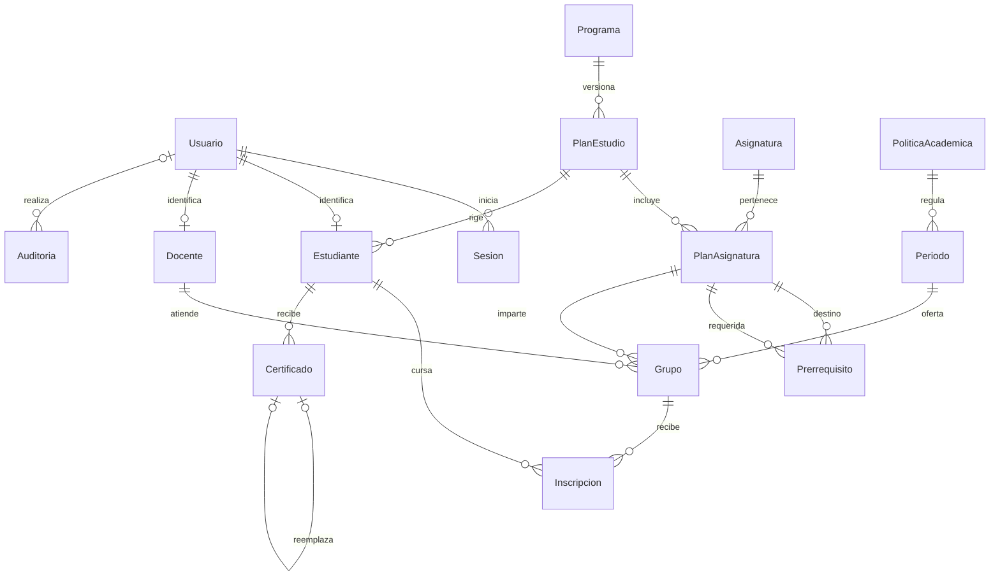

# Modelo de datos de SIGA

Descripcion tecnica contrastada con `apps/api/prisma/schema.prisma` y las migraciones existentes. Las migraciones SQL agregan restricciones y triggers no siempre representados en Prisma. Consulta el [estado](ESTADO.md) para las pruebas actuales y la [explicacion para principiantes](EXPLICACION_ARQUITECTURA.md) para un recorrido sencillo.

## Garantías persistentes

| Área               | Restricción aplicada                                                                                                                                                                                                                                                                                                     |
| ------------------ | ------------------------------------------------------------------------------------------------------------------------------------------------------------------------------------------------------------------------------------------------------------------------------------------------------------------------ |
| Identidad          | Correo único, sin espacios y en minúsculas; matrícula/empleado/claves únicos y en mayúsculas; rol compatible con persona. E04 normaliza correo y claves al crear/actualizar catálogos y personas; las nuevas cuentas quedan inactivas.                                                                                   |
| Sesiones           | Usuario existente, vencimiento posterior al alta y revocación opcional. E03 valida cookie/JWT, CSRF, rol y recurso en API.                                                                                                                                                                                               |
| Planes             | Programa+versión único; créditos y semestre positivos; ambos extremos de prerrequisito en el mismo plan; sin ciclos directos o indirectos. E04-A valida también la carga del grafo.                                                                                                                                      |
| Historial          | Restricciones SQL impiden modificar la estructura del plan con inscripciones. E04-A bloquea el contenido también si hay estudiantes o grupos asociados. Crear versión nueva copia el grafo. E04-B impide cambiar el plan de un estudiante con inscripciones/certificados; bajas conservan relaciones y revocan sesiones. |
| Oferta             | Cupo positivo y clave única por periodo en SQL. E05 valida en servicio docente activo, periodo no cerrado, asignatura del plan, ocupación activa y preservación de la identidad si hay inscripciones. La política del grupo se hereda del periodo.                                                                       |
| Matrícula RN-03    | Una inscripción por estudiante+asignatura+periodo, incluso entre distintos grupos. La unicidad incluye los registros cancelados.                                                                                                                                                                                         |
| Consistencia       | FK compuesta grupo+plan+asignatura+periodo+política y estudiante+plan. No basta proporcionar IDs existentes por separado.                                                                                                                                                                                                |
| Valores históricos | creditosSnapshot coincide con el plan al insertar; identidad, fecha de alta y snapshot no cambian después. Trigger incrementa version al actualizar.                                                                                                                                                                     |
| Notas              | NULL solo para pendiente/cancelada; calificada exige valor, incluido cero. El servicio E07 valida escala/precisión antes de guardar y exige autorización del docente asignado. La versión y auditoría evitan sobrescrituras silenciosas.                                                                                 |
| Certificados       | Código UUID aleatorio sin guiones, único (122 bits aleatorios); instantánea JSON objeto. Emitido exige fecha/ruta/SHA-256; revocado exige motivo/fecha. No se reescribe una emisión; reemplazo solo de certificado revocado del mismo alumno.                                                                            |
| Auditoría          | Registro aditivo, actor opcional para procesos del sistema; no admite update/delete ordinarios. Los servicios deben excluir secretos de JSON.                                                                                                                                                                            |

Relaciones RESTRICT, sin cascadas destructivas. Los triggers no sustituyen permisos: un administrador de PostgreSQL puede alterarlos. La instalacion local utiliza un rol de aplicacion restringido; esto no acredita seguridad para produccion. PlanEstudio.revision serializa cambios del grafo y matrículas; no equivale a la versión académica.

E05 expone administración de periodos y grupos solo a ADMINISTRADOR, y `GET /docentes/me/grupos` solo a DOCENTE. El propietario de esa consulta se deriva de la sesión autenticada. El servicio valida fechas/ventanas, pero guarda el estado PLANIFICADO/ABIERTO/CERRADO de forma explícita: no lo calcula desde el calendario. Cambiar política de un periodo con grupos se rechaza. El cupo cuenta inscripciones cuyo estado no es CANCELADA; al actualizar, el servicio bloquea la fila del grupo con `FOR UPDATE` dentro de una transacción serializable y rechaza bajar la capacidad debajo de la ocupación. Desactivar grupo es lógico. Con inscripciones se conserva la clave, plan, asignatura, periodo y docente para proteger el historial. Cada alta/cambio escribe auditoría en la misma transacción con valores anteriores y posteriores.

## Limites y reglas

La base no comprueba por si sola prerrequisitos, ventana vigente ni ausencia de sobrecupo: el servicio de matricula realiza esas validaciones y protege el registro con transacciones. La configuracion exige prerrequisitos por defecto. La provision local para nuevas cuentas dispone de un procedimiento separado; vease el README.

Las notas y creditos usan `Decimal`. Pendiente no significa cero. El promedio por periodo pondera notas calificadas por los creditos guardados; el general selecciona TODOS, ULTIMO o MEJOR segun la politica del intento calificado mas reciente de cada asignatura. El avance suma una sola vez los creditos de cada asignatura aprobada y trata los planes sin creditos. D42 acepta provisionalmente TODOS, escala de 0 a 10, minima 6 y dos decimales para demostracion; no acredita reglamento institucional.

Las fechas del periodo son `Date` y la ventana se guarda como instantes `timestamptz` y se comprueba como `[inicio, fin)`. La migracion `20261106010000_periodo_hora_mexico` compara el cierre con la fecha final en `America/Mexico_City`, zona provisional D44. La existencia de la migracion no demuestra que se haya aplicado en un entorno concreto. La nota final es `Inscripcion.notaFinal`; no se implementan parciales.

SQL no comprueba la existencia o integridad del PDF. El servicio conserva instantanea, ruta y huella, y admite recuperacion de registros pendientes o fallidos; la [operacion de respaldo](OPERACION_RESPALDO_RESTAURACION.md) explica la comprobacion conjunta de base y archivos. Auditoria no captura automaticamente cada accion: los servicios registran cambios en sus transacciones.

## Evolución

1. db:migrate aplica el esquema a desarrollo; db:test:migrate a pruebas separadas.
2. `db:seed` registra metadatos ICO-F19 en transacción serializable. Los fixtures sintéticos de pruebas se crean en esquemas temporales aislados y nunca son la semilla de desarrollo.
3. Las pruebas de integracion crean un esquema temporal aislado y retiran solo sus propios recursos; no deben borrar datos ajenos.
4. Nuevos cambios van en nuevas migraciones revisadas. Mantener checks/triggers manuales: migrate diff no modela todos esos objetos.
5. Regresion: db:validate, check, test:integration y test:e2e. Consultar ESTADO para las evidencias vigentes y sus limites.
